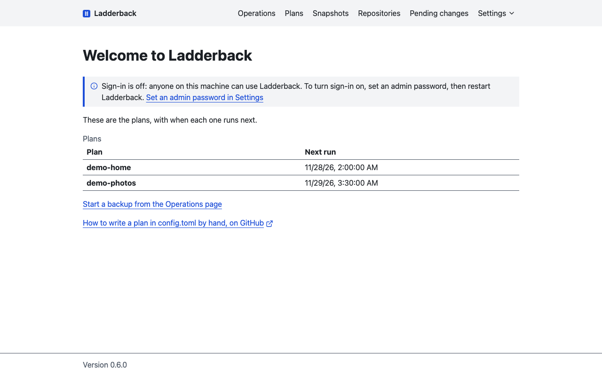

<h1>
  <picture>
    <source media="(prefers-color-scheme: dark)" srcset="crates/web/assets/brand/logo-dark.svg">
    
  </picture>
</h1>

Ladderback backs up your computers on a schedule, shows your backups in one web page, and restores files right in the browser. It runs on your own machines and is built on [rustic](https://rustic.cli.rs), a fast, encrypted backup program.

> [!WARNING]
> **Ladderback is new software.** Version 0.5.0 runs scheduled backups and restores from them in your browser, but restores arrived only in 0.4.0. Before you rely on these backups, try restoring a file into a scratch folder. The `rustic` command-line program restores from any repository Ladderback backs up to, and stays your fallback. Until the hub (M8), each computer runs its own Ladderback, with its own web page. The [roadmap](#roadmap) has the order.

## What it does

- **Backs up on a schedule.** On the Plans page, choose what to back up, into which repository, how often, and how long to keep it. A laptop that was asleep catches up when it wakes.
- **Tells you when something goes wrong.** Notifications go to webhooks, ntfy and healthchecks.io.
- **Restores in the browser.** Browse a snapshot's folders and files, restore one into a new folder, or download a file, or a folder as a tar or zip archive.
- **Shares a repository safely.** Several computers can back up into one repository: backups never wait for a lock, one computer you choose maintains it, and Ladderback warns when it sees snapshots from other computers there.
- **Keeps rustic as your way out.** Import your rustic profiles and export any plan back to one, so the `rustic` program always works on the same repositories.

## Install

Ladderback runs on each machine it backs up. Install it the recommended way for your system, then start it with `ladderback install-service`, run as yourself; the [install guide](docs/guide/install.md) has each step, updating, removing, and what macOS asks for.

- **Debian 12 or newer, Ubuntu 22.04 or newer, 64-bit Raspberry Pi OS and Fedora:** the release's `.deb` or `.rpm` [package](docs/guide/install-linux-package.md), checked against the release's `SHA256SUMS`.
- **Any other 64-bit Linux:** the [install script](docs/guide/install-linux.md), `curl -fsSL https://raw.githubusercontent.com/nledford/Ladderback/main/scripts/install.sh | bash`
- **macOS:** the same script, which builds the release from source, [signed with your own certificate](docs/guide/install-macos.md#signing-your-build); then [grant Full Disk Access](docs/guide/install-macos.md#full-disk-access-and-photos).

Building from source, the release's archive by hand and cargo-binstall are in [Other ways to install](docs/guide/other-ways-to-install.md), and the [Docker image](docs/guide/docker.md) isn't a supported way to run Ladderback yet.

## Quick start

Open the web UI at `http://127.0.0.1:9898`, then:

1. **Create a repository** on the Repositories page, or connect one you already have.
2. **Add a plan** on the Plans page: what to back up, a schedule, and which snapshots to keep.
3. **Run it now** from the Operations page, and see its next run on the Plans page.
4. **Restore a file** from the Snapshots page into a new folder, to see that the backup works.
5. **Turn sign-in on** in Settings, on the Admin password tab.

[Getting started](docs/guide/getting-started.md) walks through each step. For people at home in a terminal and for rustic users, the [user guide](docs/guide/README.md)'s Advanced part covers `config.toml`, importing rustic profiles, secrets, sign-in and remote access.

## Ladderback or Backrest?

Ladderback borrows Backrest's user-facing model: repositories, plans, schedules, hooks, an operation log and restore into a new folder. The difference is the engine underneath. Backrest wraps the `restic` CLI. Ladderback links rustic's library, `rustic_core`, and inherits rustic's lock-free repository design.

**Ladderback may suit you better if you:**

- back up **several machines into one shared repository**. In Backrest, each plan runs `restic forget` after its backup, which takes an exclusive lock and blocks other hosts' backups ([backrest#244](https://github.com/garethgeorge/backrest/issues/244)). In Ladderback, backups never wait for a lock, and with the hub (M9) one owner per repository runs maintenance;
- don't want repository **passwords and backend keys copied to other machines**. Backrest's multi-host sync pushes shared repositories to clients, credentials included. With Ladderback's hub (from the MVP's release), the hub keeps its own secrets, and paired machines never send theirs;
- back up **laptops**. Missed runs catch up by default, and the scheduler notices sleep and wake;
- want an **AI agent** to check on and run backups. Ladderback has an MCP server built in, `ladderback mcp`, which takes a token scoped to reading, running or previewing, and can't restore or delete. An AI agent can also propose plans, over the API or through MCP, which change nothing until a person approves them in the web UI;
- want **secrets out of the config file**: a password command, the system keyring, a file or an environment variable. A missing secret fails the job instead of silently becoming an empty string;
- want **time-based retention** (`keep-within-*`), not just counts;
- already use **rustic profiles** and want to keep using the CLI on the same repositories;
- want **restores that don't overwrite by accident**. A restore goes into a new folder by default, and one over the original files is offered only from the machine's own web UI, behind a dry-run summary and a confirmation.

**Backrest is the better choice if you:**

- want the **most proven restores**. Backrest is mature. Ladderback's web UI restores a file or folder, and downloads one as a file, a tar or a zip, but these arrived only in 0.4.0 (M3), and some cases are still open, such as an in-place restore over a path that has since become a folder or a symlink;
- use **Windows**;
- use **restic** and want to keep restic maintaining your repositories. Restic must never prune a repository Ladderback manages;
- need **multiple user accounts** or a way to run **arbitrary repository commands** from the UI. Ladderback has neither;
- prefer restic's longer track record over rustic, which is the younger project.

The [technical design](docs/design/README.md#relationship-to-backrest) has the full comparison, with sources.

## For advanced users

For people at home in a terminal and for rustic users. The [user guide](docs/guide/README.md)'s Advanced part has each of these in full.

### Why a manager

Without one, each machine runs rustic from its own cron job or timer. Failures surface only if someone reads the logs, a laptop that was asleep at 02:00 silently skips its backup, and retention on a shared repository needs hand-coordination between hosts. Ladderback turns rustic into a managed service on each machine, with one place to see them all.

### Platforms

Ladderback supports Linux and macOS. Linux means 64-bit (x86_64 or aarch64) with glibc 2.35 or newer: 32-bit ARM and musl distributions such as Alpine aren't supported ([Install](docs/guide/install.md)). Windows is out of scope; Ladderback runs inside WSL2 as a Linux install, for files inside WSL, but [it isn't a way to back up Windows](docs/guide/install.md#windows-and-wsl2).

### One program, with its web UI

Ladderback is one self-contained program with its web UI built in. It runs headless on servers and as a user service on desktops and laptops ([Running as a service](docs/guide/running-as-a-service.md)). The web UI is drawn by one shared, keyboard-tested component set, accessible (WCAG 2.2 AA) and localization-ready, with Settings in tabs and a choice of a narrow or a full-width page.

### config.toml and rustic profiles

Plans can be written in `config.toml` as well as created, edited and deleted on the Plans page ([Plans in config.toml](docs/guide/first-plan.md)). Existing rustic profiles import as plans, and any plan exports back to a profile, so the `rustic` CLI always stays an option.

### Secrets

A repository's password can stay out of `config.toml`, in the system keyring, a file, an environment variable or a password command; a missing secret fails the job instead of silently becoming an empty string ([Moving a repository's password out of config.toml](docs/guide/secrets.md)).

### Restores

A restore goes into a new folder by default. A restore in place, over the original files, is offered only from the machine's own web UI, after a dry-run summary of what would change. Restores and downloads need a confirmation: the admin password, or the snapshot's short ID when sign-in is off ([Sign-in and remote access](docs/guide/remote-access.md)). The Snapshots page also shows each repository's stats.

### AI agents and MCP

`ladderback mcp` is an MCP server over stdio. An AI agent can read a status summary, with overdue plans and unreadable repositories, and plans, repositories, snapshots and history; run a plan and wait for it, cancel a backup, test a repository, preview a forget or a profile import, and export a plan as a profile. It drives a running instance, with a scoped API token when sign-in is on; a headless session of its own when none is running; or a throwaway scratch setup to try it on. Driving a running instance, it can also count what a draft plan would back up within the folders you allow, and propose plan changes. It can't restore, delete or change the configuration. `ladderback mcp call` runs the same tools from a shell or a script without an MCP client, printing each result as a line of JSON.

An AI agent whose API token has the Configuration permission can propose adding, changing or removing plans, over the REST API or through `ladderback mcp` driving a running instance. Nothing changes until a person approves it on the Pending changes page, with the same confirmation as a restore. A proposal that could delete snapshots shows what it would forget, before and after, and is approved from that preview. Proposals can't yet touch repositories, hooks or maintenance. The AI agents tab in Settings sets what an AI agent may do without a token, and [API tokens and AI agents](docs/guide/api-tokens.md) has which permissions to give.

## Roadmap

Ladderback 0.5.0 holds milestones M0 to M3b: backups run on their schedules, and snapshots can be browsed, restored and downloaded in the web UI. A milestone is done when its acceptance scenarios pass, including keyboard-only and screen-reader checks for the UI. [CHANGELOG.md](CHANGELOG.md) has what each release brought, and each [milestone's page](https://github.com/nledford/Ladderback/milestones) its issues.

Since 2026-11-22 the work comes in three phases: first the [MVP: Ready for real-world testing](https://github.com/nledford/Ladderback/milestone/12), what you need to use Ladderback for real and start testing it, taken from M8, M9 and M10; then the rest of M4, M5 and M8 to M10, before 1.0.0; and [after 1.0.0](https://github.com/nledford/Ladderback/milestone/13), M6, M7, M11, and smaller improvements and rare edge cases.

- [x] **M0: Skeleton.** Workspace, CI, test tooling (acceptance scenarios, mutation testing, browser tests with accessibility checks) and an embedded web UI shell.
- [x] **M1a: Engine.** Backups through `rustic_core` in an isolated worker process, with live progress, warnings, cancellation and deadlines.
- [x] **M1b: Single-machine MVP.** Connect or create repositories; secrets; plans and hooks in `config.toml`; rustic profile import and export; manual backups with live progress; snapshot list; operation history; manual forget, prune and check.
- [x] **M2: Schedules and errors.** Scheduler with catch-up after sleep, time zones and retries; notifications to webhooks, ntfy and healthchecks; systemd and launchd service install; optional sign-in. The first usable release.
- [x] **M3: Browse, restore and automation.** Snapshot browser; restore into a new folder or in place; downloads as tar or zip; repository stats; scoped API tokens; an MCP server for AI agents; macOS builds from source that keep their Full Disk Access across upgrades. The first release with restores in the web UI.
- [x] **M3b: Shared UI components.** One accessible component set for every widget the pages use, the pages moved onto it, a full-width page option, and Settings in tabs.
- [ ] **MVP: Ready for real-world testing.** Pairing machines with a hub and seeing them on its dashboard; offline alerts; one owner for each shared repository, with the owner prune guard; the install, getting-started and hub docs.
- [ ] **M4: AI agents.** MCP tools for what people ask AI agents most, such as comparing snapshots and reading the log, and proposals for repositories, hooks and maintenance.
- [ ] **M5: Scheduled maintenance.** Forget, prune and check on their schedules, one at a time by default, each check's result kept and shown.
- [ ] **M6: Notification channels.** Gotify, Discord, Slack, email, Telegram, Pushover, Pushbullet, web push and a webhook you template. After 1.0.0.
- [ ] **M7: Japanese.** The first language after English, with a language choice in the web UI. After 1.0.0, released once its review is done.
- [ ] **M8: Hub, visibility.** Pair machines with a hub; one dashboard with the status, live progress, history, warnings and errors of every connected computer; offline alerts; any installed machine can become the hub, and the Docker image runs one on a machine of its own.
- [ ] **M9: Hub, control and maintenance.** Repository ownership, so that exactly one place runs forget, prune and check for each repository, whichever machines back up to it; maintenance managed from the hub; remote run and cancel; opt-in restores from the hub.
- [ ] **M10: Polish.** A run condition for metered networks, charts, database rebuild, user docs.
- [ ] **M11: Menu bar and tray icon.** Backup status at a glance in the macOS menu bar and the Linux tray, for a machine and for the hub. After 1.0.0.

Not planned for v1: Windows, multiple users, and rustic's `copy`, `merge`, `rewrite`, `repair`, `webdav` and `mount` commands (use the CLI).

## Documentation

- [The user guide](https://nledford.github.io/Ladderback/) ([source](docs/guide/README.md)): installing and a first backup in the web UI, for everyone; then an Advanced part with the other ways to install, the service, `config.toml`, secrets, sign-in and remote access, and API tokens and AI agents.
- [PRODUCT.md](PRODUCT.md): who Ladderback is for, what it does and doesn't do.
- [docs/design/](docs/design/README.md): architecture, safety invariants, data model, milestones and decisions.

## Contributing

Ladderback is built for its author's own machines first and published for other rustic users, without support promises. Issues and discussion about the design are welcome. Development is behaviour-first and test-first; see [docs/design/development.md §13](docs/design/development.md#13-development-method) for the method and [AGENTS.md](AGENTS.md) for the working rules. Setting up the browser journeys on Fedora is in [§13.2](docs/design/development.md#132-behaviour-first-bdd).

**Help test it.** Some setups haven't been tried on a real machine yet: other Linux distributions and desktops, keyrings, ARM, headless servers, Wi-Fi rules, WSL2. Each [issue labeled `needs real-world test`](https://github.com/nledford/Ladderback/issues?q=is%3Aissue%20is%3Aopen%20label%3A%22needs%20real-world%20test%22) lists the steps and what to report; use a scratch repository and a made-up password.

## License

Licensed under either of [Apache License, Version 2.0](LICENSE-APACHE) or [MIT license](LICENSE-MIT), at your option.
