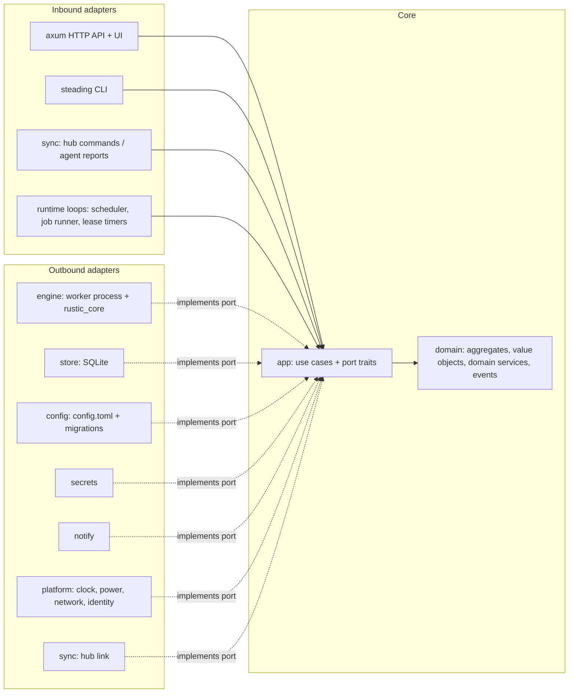

# Steading — Design

> **Status:** Draft v0.4 · 2026-11-08
> **Name:** Steading (binary `steading`). A steading is a farmhouse with its outbuildings: the hub and its agents.

A self-hosted backup manager for [rustic](https://rustic.cli.rs). It provides a web UI for connecting repositories, defining backup plans and schedules, and watching backup status and errors across several computers. Think "[Backrest](https://github.com/garethgeorge/backrest), but built on `rustic_core`". It is written from scratch in Rust, and the frontend is written in Leptos.

---

## 0. Safety invariants

Every later section serves these. Each one has a single enforcing component and a test that proves it.

| # | Invariant | Enforced by | Verified by |
|---|---|---|---|
| I1 | Among agents registered to a hub, each repository has at most one maintenance owner, keyed by its rustic repository ID. Ownership is a lease, so a lost or revoked owner stops on its own. A standalone agent can't rule out a second standalone owner and warns instead. | Hub ownership registry with leases; standalone warning (§7.3) | Two agents request `local` for one repo: the second is rejected; an expired lease stops scheduled maintenance |
| I2 | Prune never uses `instant-delete` or `early-delete-index`. | `engine` builds `PruneOptions` itself; no config key exposes either flag (§7.3) | Unit test on the mapping; a config containing either key fails to load |
| I3 | No Steading backup writes a snapshot after its deadline (index read start + `keep-delete` − prune margin), except a snapshot write already in progress at the deadline, which the margin covers. | `Deadline` rule in `domain`; kill decision in `app`; worker watchdog and daemon kill; backed by the owner's prune guard (§7.3) | Fake-clock tests of the rule and the kill decision; one `@e2e` scenario with a real worker, a short deadline and a scratch repo asserting no snapshot is written |
| I4 | Resolved secrets never appear in argv, worker or hook environments, logs, hook templates, sync messages or the UI. | `JobSpec` on stdin, scrubbed environments and the `Redactor` (§3.1, §10.2) | A canary secret is absent from every log, event and child environment |
| I5 | Destructive restic commands (`prune`, `forget`, `rewrite`, `repair`) are never run against a Steading-maintained repo, and the UI says so. | Repo page warning; Steading never invokes restic (§7.3) | Doc and UI review |
| I6 | Forget, run by any owner, only deletes snapshots that a plan owns, by tag, or that the user explicitly adopted or selected. | Forget algorithm (§7.3) | Untagged snapshots survive a forget run |
| I7 | Maintenance operations on one repository run one at a time. | `OperationStore::try_start`, backed by a partial unique index (§9) | Store contract test: a second maintenance start on the same repo is refused; `maintenance/serialization.feature` |

---

## 1. Goals and non-goals

### Goals

1. **Plans and schedules.** Define what to back up, from which machine, into which repository, how often, and how long to keep it.
2. **One place to see every machine.** Show status, live progress, history, warnings and errors for every connected computer.
3. **Lock-free by construction.** Use rustic's lock-free design. Backups on many hosts and a prune can overlap safely within the limits in §2.2. Exactly one place runs `forget`/`prune`/`check` for each repository (I1).
4. **Compatible with rustic profiles.** Import existing rustic TOML profiles, and export any plan back to a profile, so users can always drop back to the `rustic` CLI. No lock-in.
5. **Single self-contained binary.** The same program runs as daemon, hub, worker and CLI, with the web UI embedded. It runs headless on servers and as a user service on desktops and laptops.
6. **Linux and macOS only.** That covers Bazzite desktops, Linux servers and a MacBook. Windows is out of scope (see §1 non-goals).

### Non-goals (for v1)

- Not a general rustic GUI covering every command (`copy`, `merge`, `rewrite`, `repair`, `webdav`, `mount`). Those stay CLI-only at first.
- No support for restic repositories with restic doing maintenance. See §7.3 for why restic must never prune a repository this tool manages.
- No multi-tenant SaaS and no multiple users. This is one owner and their machines.
- No mobile app. A responsive web UI is enough.
- **No Windows support.** Code stays portable where it costs nothing: paths via `std::path`/`camino`, never hard-coded `/`; platform code isolated in the `platform` crate. That way Windows could be added later without a rewrite, but it isn't designed, built or tested for.

### Relationship to Backrest

Backrest wraps the `restic` CLI. Steading keeps its user-facing model (repos, plans, schedules, hooks, an op log, restore into a new folder) and changes what restic's locking and Backrest's single-host origins force on it.

| | Backrest | Steading |
|---|---|---|
| Engine | Shells out to `restic` | Links `rustic_core`, runs each operation in a child process (§4.1) |
| Forget with shared repos | Per-plan `restic forget` after each backup takes an exclusive lock and blocks other hosts' backups ([#244](https://github.com/garethgeorge/backrest/issues/244)) | One maintenance owner per repo; backups never wait for a lock (§7.3) |
| Missed runs on laptops | Skipped unless the schedule uses the last-run clock ([#372](https://github.com/garethgeorge/backrest/issues/372)) | Catch-up by default (§5) |
| Plan ↔ snapshot link | Tags `plan:<id>` and `created-by:<instance>` | Same idea: tags `steading-plan:<id>` and `steading-agent:<id>` (§7.3) |
| Multi-host | Peer sync; shared repos are pushed to clients **including passwords and backend keys** | Hub and agents; the hub keeps its own secrets and agents never send theirs (§10.2) |
| Secrets in config | Plaintext in `config.json`; `${VAR}` in repo URI, env and flags; a missing variable becomes empty | Command, keyring, file, env or inline sources; a missing reference fails the job (§10.2) |
| Retention | Counts only | Full `KeepOptions`, including `keep-within-*` |
| In-place restore | Not offered | Offered from the agent's own UI only, behind a dry-run summary (§10.4) |
| Not carried over | | `RunCommand` (arbitrary repo commands), multiple users, Windows |

---

## 2. Background: what we build on

### 2.1 `rustic_core` (library, Apache-2.0 OR MIT)

Steading pins `rustic_core` and `rustic_backend` to **one git revision of `rustic-rs/rustic_core` `main`**, because the per-file error reporting it needs (`Progress::error`, `SnapshotSummary.error_count`) is not in the latest release, 0.13.0. It moves to crates.io as soon as a release (expected 0.14) contains them. The table was checked against `main` at `01fe284` (2026-11-05):

| Need | API |
|---|---|
| Open repo | `Repository::new_with_progress(&RepositoryOptions, &RepositoryBackends, pb)?.open(&Credentials)?` |
| Repo identity | `repo.config().id`: a random ID created at `init`, the same on every machine |
| Backends | `rustic_backend::BackendOptions { repository, repo_hot, options, options_hot, options_cold }.to_backends()` (local, REST, rclone, OpenDAL: S3, B2, SFTP, …) |
| Backup | `repo.to_indexed_ids()?.backup(&BackupOptions, &PathList, SnapshotFile)` |
| Snapshots | `get_all_snapshots()`, `Grouped::from_items(snapshots, SnapshotGroupCriterion)`, `delete_snapshots(&[SnapshotId])` |
| Retention | `KeepOptions` (all `keep-*` and `keep-within-*`, incl. quarter/half-yearly) and `ForgetGroups::from_grouped_snapshots_with_retention(grouped, &KeepOptions, &Zoned)` |
| Prune | `prune_plan(&PruneOptions)` then `prune(&opts, plan)` |
| Check | `check(CheckOptions) -> CheckResults` |
| Browse / restore | `node_from_snapshot_path("SNAP[:PATH]", filter)`, `ls(&Node, &LsOptions)`, `prepare_restore` and `restore`, `dump(&Node, &mut impl Write)` |
| Stats | `infos_files()`, `infos_index()` |
| Progress | `trait ProgressBars { fn progress(ProgressType, prefix) -> Progress }`. A progress object has `set_length`/`inc`/`set_title`/`finish`/`error(item, during, message)` (`error` is on `main` only) |

Facts that shape the design:

- **The API is synchronous and uses rayon internally.** Nothing in it is `async`.
- **The OpenDAL and REST backends (and so rclone) each create their own Tokio runtime** and call `block_on` on it. Calling them from inside a Tokio task panics with "Cannot start a runtime from within a runtime". `spawn_blocking` avoids the panic; the worker process (§4.1) avoids it too, and exists mainly for the other reasons listed there.
- **There is no cancellation API.** A running backup or prune cannot be stopped cooperatively.
- **`dump` handles files only.** A directory download is built by walking `ls` and dumping each file into a tar or zip stream. `dump` and `prepare_restore` need `to_indexed()`, which holds the full index in memory.
- **Most option structs are `serde`-deserializable with `kebab-case` and `deny_unknown_fields`**: `KeepOptions`, `Excludes` (`globs`, `iglobs`, `glob-files`, `iglob-files`), `LocalSourceFilterOptions` (`git-ignore`, `exclude-if-present`, …), `SnapshotOptions`, `ParentOptions`, `BackupOptions`, `BackendOptions`, `CredentialOptions`. They match the TOML keys rustic profiles use. **`PruneOptions`, `CheckOptions`, `RestoreOptions` and `LsOptions` have no serde support**; Steading defines its own config structs for them and maps them onto the core types. `CheckResults` isn't `Serialize` either, so the worker reports a mirror type.
- **`deny_unknown_fields` with `#[serde(flatten)]`** works for flat types: `Excludes`, `LocalSourceFilterOptions`, `SnapshotOptions` and `KeepOptions` flattened together still reject unknown keys. Flattening `BackupOptions`, which has flattens of its own, next to other strict types is expected to fail (serde's documented limitation; not tested). See §6.1.
- **The default snapshot grouping is `host,label,paths`**. `keep-within-*` is measured from the newest snapshot in each group, not from now, so a machine that stops backing up keeps its last snapshots.
- **`rustic_core` does not build for `wasm32`** (`errno`, `getrandom`, `xattr`). The UI cannot share `rustic_core` types (§8.3).
- **`rustic_config` is empty.** The profile structs (`[repository]`, `[backup]`, `[[backup.snapshots]]`, `[forget]`) live in the `rustic` CLI crate (`rustic-rs`). It is on crates.io, but the fields Steading needs are private, so we mirror that layout ourselves with Steading-owned types that the engine adapter maps onto the core option types (§3.2, §6.1).

### 2.2 Why lock-free matters

`rustic prune` does not delete unreferenced pack files right away. It records them in a `packs_to_delete` list in a new index file, stamped with the time the prune plan was made, and only deletes them on a **later** prune once that stamp is at least `keep-delete` old (rustic's default is **23 h**; Steading defaults to **6 days**, §7.3). If a snapshot written in the meantime uses a marked pack, the next prune recovers it.

A backup never uses blobs from packs that are already marked: it loads only the live pack list. The race is a backup that **loaded the index before a prune marked the pack** and is still running when a later prune deletes it. The old index files are only removed at the end of the marking prune, so a backup that loads the index while that prune runs is also exposed. The safe condition is therefore:

> every backup finishes within `keep-delete` − the duration of the prune that marked the pack.

Steading enforces this with a worker deadline (I3, §7.3). Two rules are absolute: never `instant-delete`, never `early-delete-index` (I2). rustic's FAQ also notes that concurrent forget/prune runs are untested and that `check` can trip over snapshots a concurrent forget just removed, so maintenance on one repo is serialized (I7).

### 2.3 Leptos

- Stable **0.8.23**. **0.9.0-rc1** is on `main`. Target 0.8, and move to 0.9 once it is stable.
- We use **client-side rendering (CSR)**, built with `trunk` to WASM. The build output is embedded in the daemon binary (`rust-embed`) and served by axum. Rationale in §8.1.

---

## 3. Architecture

### 3.0 Runtime topology

```
                       ┌──────────────────────── hub machine ─────────────────────────┐
  Browser ──HTTPS──►   │  steading serve --hub                                         │
  (Leptos WASM UI)     │   ├─ HTTP API + UI (axum)      ├─ Hub registry (agents, plans,│
                       │   ├─ Scheduler                 │   repo owners)               │
                       │   ├─ Op log (SQLite)           ├─ Maintenance runner          │
                       │   │                            │   (forget/prune/check)       │
                       │   └─ local agent ──spawns──►  steading worker ──► repo        │
                       └──────────────▲────────────────────────────────────────────────┘
                                      │ WebSocket (agent dials out, TLS, signed identity)
             ┌────────────────────────┼─────────────────────────┐
     ┌───────┴────────┐       ┌───────┴────────┐        ┌───────┴────────┐
     │ laptop (agent) │       │ server1 (agent)│        │ server2 (agent)│
     │ scheduler      │       │ scheduler      │        │ scheduler      │
     │ op log         │       │ op log         │        │ op log         │
     │ worker ─► repo │       │ worker ─► repo │        │ worker ─► repo │
     └────────────────┘       └────────────────┘        └────────────────┘
```

**One binary, three roles:**

| Role | Command | Runs where | Responsibility |
|---|---|---|---|
| **Agent** | `steading serve` | every machine | Local config, scheduler, op log, spawning workers, local web UI. Works fully standalone. |
| **Hub** | `steading serve --hub` | one machine (often a server) | Everything an agent does, plus an agent registry, aggregated history, the repo ownership registry, maintenance for hub-managed repos, notifications |
| **Worker** | `steading worker` (internal) | spawned per operation | Runs exactly one `rustic_core` operation, streams events to stdout, then exits |

Every agent is useful alone. Hub mode is opt-in, and an agent that can't reach the hub keeps backing up on schedule. It stores events in a persistent outbox and replays them when it reconnects.

### 3.1 Domain model (DDD)

Steading's hard problems are domain rules, not CRUD: who may prune a repository, which snapshots a policy may delete, when a backup must give up, when a missed run catches up, what a restore may overwrite. Those rules get names, types and tests of their own, independent of rustic, SQLite, axum or the sync protocol.

**Ubiquitous language.** These terms mean exactly this in code, tests, UI copy and docs.

| Term | Meaning |
|---|---|
| Agent | One machine running `steading serve`, identified by its agent ID |
| Hub | The agent running `--hub`; holds the registry, ownership and aggregated history |
| Plan | What to back up, from which agent, into which repository, when, and how long to keep it |
| Repository | A rustic repository, identified by its **repository ID**. An **alias** is one agent's local name for it |
| Operation | One run of one action (backup, forget, prune, check, restore, …) with a lifecycle: `Queued` → `Running` → `Succeeded` / `SucceededWithWarnings` / `Failed { reason }` / `Cancelled`. A missed deadline is `Failed { reason: DeadlinePassed }` |
| Snapshot | A rustic snapshot, read from the repository; never created or edited except through an operation |
| Plan tags | `steading-plan:<id>` and `steading-agent:<id>`; they make a snapshot **managed** by a plan |
| Unmanaged group | Untagged snapshots, grouped by the repository's `group-by` |
| Orphaned group | Tagged snapshots whose plan or agent no longer exists |
| Adopt | Retag an unmanaged or orphaned group into a plan |
| Maintenance owner | The single party that runs forget, prune and check for a repository |
| Claim / Grant / Lease | An agent's request to own maintenance; the hub's acceptance; the time-limited, epoch-numbered form of that acceptance |
| Deadline | The latest time a backup may write its snapshot (I3) |
| Prune margin | 1 h + the longest recorded prune on that repository |
| Catch-up | One run in place of any number of runs missed while the agent was off or asleep |
| Step-up confirmation | Re-entering the password (or typing the snapshot ID when auth is off) before a restore or download |

**Bounded contexts.**

| Context | Kind | Aggregates and domain services | Rules it protects |
|---|---|---|---|
| **Shared kernel** | — | `RepositoryId`, `AgentId`, `PlanId`, `OperationId`, `SnapshotRef { id, time, host, label, paths, tags }`, `Timestamp` | Used by every context; changes need agreement across all of them |
| **Planning** | Core | `AgentConfig` (root; owns `Plan` and `RepositoryConfig` entities), value objects `Schedule`, `RetentionPolicy`, `SourceFilter`, `Hooks`, `RetryPolicy`, `SecretRef` | Plan IDs unique per agent; a plan names an existing repository alias; schedules and retention validate |
| **Execution** | Core | `Operation` (root; one run's lifecycle), `PlanSchedule` (root; per plan: `next_run`, `last_success`, active operation, retry attempt), domain services `NextRun` (cron, interval, jitter, time zone, catch-up), `Deadline`, `RetrySchedule`, `WakeDetector` (wall-clock vs monotonic samples) | Valid lifecycle transitions; catch-up collapses missed runs; overlap policy; deadline (I3); retries stop at the next scheduled run |
| **Maintenance** | Core | `RepositoryOwnership` (root; claims, grant, lease, epoch; the "no other agent uses this repo" facts are passed in by the use case), domain services `ForgetSelection` (managed / orphaned / unmanaged partition and the delete list), `PruneGuard` | One owner (I1); never instant delete (I2); forget only touches managed snapshots (I6); serialized maintenance (I7, enforced atomically by the store) |
| **Restore** | Supporting | `RestoreRequest` (root), `RestorePolicy` | New folder by default; in-place only from the agent's own UI; hub restores need `allow-hub-restore`; step-up confirmation |
| **Fleet** | Supporting | `Agent` (root; identity, hostname), `PairingToken` (single use, TTL), `HostnameRegistry` domain service | Unique hostnames; tokens used once; re-pairing reuses identity |
| **Profile interop** | Supporting | Anti-corruption layer only (`adapters/interop`): translates rustic profiles to and from Planning | List replacement, hook order, `[snapshot-filter]` export rules (§6.2) |
| **Secrets** | Generic | `SecretRef`, `Redactor` (replaces every resolved secret value, and its common encodings, with `***`) | No secret in logs, templates or sync messages (I4) |
| **Notifications, auth** | Generic | Notification rules over domain events; sessions | — |

**Context map.** Planning feeds Execution (plans become operations) and, through the hub, Maintenance (published plans carry retention). Execution emits domain events that Maintenance, notifications and the sync outbox consume. Two anti-corruption layers keep foreign models out: profile interop for rustic's TOML model, and the engine adapter for `rustic_core`'s types. The sync protocol in `api` is the published language between agent and hub; `app` speaks its own `AgentReport` and `HubCommand` types, and the sync adapter translates.

**Domain events and their consumers.**

| Event | Consumed by |
|---|---|
| `OperationQueued`, `OperationStarted`, `OperationFinished { outcome }` | UI live updates, sync outbox, notifications (`backup.*`, `forget.failed`, `prune.failed`, `check.failed`) |
| `SnapshotCreated` | Snapshot catalog refresh |
| `RetryScheduled`, `BackupMissed` | Notifications (`backup.retrying`, `backup.missed`) |
| `CheckFoundErrors` | Notifications (`check.errors`) |
| `PruneRefused`, `ClaimRejected`, `MaintenancePaused { reason }` | Notifications (`prune.refused`, `repo.claim_rejected`, `repo.maintenance_paused`) |
| `MaintenanceGranted`, `LeaseExpired` | Maintenance scheduling on the agent |
| `UnmanagedGroupsFound` | Notifications (`repo.unmanaged_groups`), repository page |
| `AgentPaired`, `AgentWentOffline` | Dashboard; notifications (`agent.offline`) |

The sync outbox (§7.2) persists the events the hub needs.

**Retention evaluation stays in rustic.** `ForgetSelection` decides *which* snapshots each policy applies to; applying `keep-*` rules to a group is delegated to the `Retention` port, implemented with rustic's own `ForgetGroups`, so Steading never reimplements retention. The export golden test (§6.2) checks the two agree.

### 3.2 Code architecture: hexagonal, with a DDD core

Steading's complexity sits at its edges: one set of rules is driven by an HTTP API, a CLI, a scheduler and hub commands, and it drives a rustic engine in a child process, SQLite, a WebSocket, OS keyrings, power and wake signals, notification channels and the clock. Ports and adapters name exactly that, and let every rule be tested with fakes for all of it.

| Option | Verdict |
|---|---|
| **Hexagonal (ports and adapters) around a DDD core** (chosen) | Fits many inbound drivers and many swappable outbound systems. The domain and application crates form two inner rings, as in Onion |
| Clean Architecture | Same dependency rule, but its presenters and interactor/output-port pairs add ceremony with no payoff: the UI is a separate WASM app consuming JSON |
| Onion | Equivalent rings; Hexagonal's port vocabulary describes the many external actors better. The inner split is borrowed from it |
| Layered by technology (v0.2's `daemon` crate holding server, scheduler, store and runner) | Rejected: lease, deadline and forget rules would sit next to axum and sqlx, untestable without them |



**Inbound ports (use cases in `app`).**

- **Agent:** `RunBackup`, `TickScheduler`, `CancelOperation`, `RunMaintenance` (forget, prune, check), `EnforceDeadlines`, `AdoptGroup`, `RequestRestore`, `Download`, `ImportProfile` / `ExportProfile`, `EditConfig`, `ApplyRepoGrants`, read-side queries for the dashboard.
- **Hub:** `PairAgent`, `ReportRepos` (claims), `DecideClaim`, `IngestHeartbeat`, `IngestOpEvents` (and acknowledge), `RenewLeases`, `ExpireLeases`, `MarkAgentOffline`, `ForwardCommand` (run, cancel, restore, fetch log).

Each adapter translates its input, calls one use case, and maps the result; no adapter holds a rule. The long-running loops (scheduler tick, job runner, lease timers, wake checks) are async functions in `app` driven by the `Clock` port; the composition root only spawns them.

**Outbound ports (traits in `app`).**

| Port | Capability | Real adapter | Test double |
|---|---|---|---|
| `Engine` | Repository ID, init, test connection, backup, list and delete snapshots, retag (for Adopt), prune, check, restore, ls, stats; returns a stream of `EngineEvent`s. `dump` returns a byte stream carried on its own pipe, separate from the event stream | Spawns `steading worker` (links `rustic_core`) | Scripted fake engine |
| `Retention` | Pure: apply a `RetentionPolicy` to `SnapshotRef`s at a given `now` | `rustic_core::ForgetGroups`, in-process | Small keep-last / keep-within fake; the shared contract suite checks it against the real adapter |
| `OperationStore` | Operations and queue; `try_start` refuses a second running maintenance operation per repo (I7) | sqlx SQLite | In-memory |
| `ScheduleStore`, `SnapshotCatalog`, `Outbox`, `LeaseCache` (agent), `OwnershipRegistry` and `AgentRegistry` (hub) | Persistence | sqlx SQLite | In-memory |
| `ConfigStore` | Load (parsing and migrating old schemas), and atomically save `AgentConfig` | TOML file with version history | In-memory |
| `SecretResolver` | Resolve a `SecretRef` | Command, keyring, file, env | Map-backed fake |
| `Clock` | Wall-clock and monotonic time, `sleep_until` | System clocks, tokio timers | Controllable fake clock that fires timers when advanced |
| `Random` | Jitter, UUIDv7 IDs, epochs, pairing tokens | OS randomness | Seeded |
| `Identity` | The agent's Ed25519 key: public key and signing | Key file in the data dir | Fixed test key |
| `Platform` | AC power, metered network, network ready | Linux / macOS modules | Scripted fake |
| `EventPublisher` | Deliver domain events to in-process subscribers (UI, outbox, notifications) | Broadcast channel | Recording fake |
| `Notifier` | Deliver a rendered notification | reqwest, lettre | Recording fake |
| `HubLink` / `AgentLink` | Send `AgentReport`s to the hub / `HubCommand`s to an agent | WebSocket sync | In-memory pair |
| `HookRunner` | Run hook commands with a scrubbed environment | Process spawner | Recording fake |

**Port style.** Ports are object-safe traits used as `Arc<dyn Port>`, written with `#[async_trait]` so their futures are `Send` and use cases can be spawned. One boxed future per port call costs nothing next to the I/O behind it, and the composition root stays readable with a dozen ports. Streams are `futures::stream::BoxStream`. No port signature mentions a tokio, sqlx, axum or rustic type.

**Port contract tests.** For each port, `app` exports a generic contract suite (feature `fakes`). The fake runs it in `app`'s tests, and each adapter crate runs the same suite against its real implementation, so a fake can't drift from reality.

**Dependency rule, enforced in CI.**

- `domain` has no I/O, no async and no ambient time or randomness. It may use `serde`, `thiserror`, `uuid` (without `v4`/`v7` features), `jiff` (with `tzdb-bundle-always`, so time zones validate in the browser) and the cron crate with its time library (`croner` and `chrono`; M0 confirms both build for `wasm32`).
- `app` depends only on `domain`, `async-trait` and `futures`.
- **Banned crates:** a CI step runs `cargo tree -e normal,build --prefix none` on `domain` (also with `--target wasm32-unknown-unknown`) and on `app`, and fails if `tokio`, `sqlx`, `axum`, `hyper`, `reqwest`, `rustic_core` or `rustic_backend` appears. Dev-dependencies are excluded, so tests may use a runtime.
- **Banned calls:** `clippy.toml` `disallowed-methods` / `disallowed-types` in `domain` and `app` forbid `std::fs`, `std::env`, `std::process`, `std::net`, `SystemTime::now`, `Instant::now`, `jiff::Timestamp::now`, `jiff::Zoned::now`, `Uuid::now_v7` and `rand`. Time and randomness come from `Clock` and `Random`.
- **wasm build:** CI builds `domain` for `wasm32-unknown-unknown`. This proves the UI can reuse its validation (schedules, retention syntax); purity is enforced by the two checks above, not by the wasm build.
- Adapters depend on `app` and `domain`, never on each other. Only the composition root (`src/main.rs`) knows every adapter and wires them per role: agent, hub, worker, CLI.
- The worker binary is an adapter: it maps a `JobSpec` onto `rustic_core` calls and reports events. It makes no policy decisions: deadlines, snapshot IDs to delete and retag targets all arrive in the `JobSpec`. Its watchdog is a thin loop that applies the `Deadline` rule from `domain`.

---

## 4. Components

### 4.1 Worker process (the engine boundary)

Each operation (backup, forget, prune, check, restore, ls, dump, stats) runs in a **child process**:

```
daemon ──stdin: JobSpec (JSON)──► steading worker
daemon ◄─stdout: NDJSON Event stream── (progress, log, warning, result)
daemon ──SIGTERM → (grace) → SIGKILL──► cancel
```

Why a subprocess instead of `spawn_blocking`:

1. **Cancellation.** `rustic_core` has none, but a process can be killed. The worker installs a SIGTERM handler that stops emitting events and exits; without it the grace period would be meaningless. Killing is safe for data:
   - An interrupted backup leaves only unreferenced packs and no snapshot, and the next prune cleans them up. On the local backend it also leaves `*-tmp-*` files, which nothing in rustic removes; the next job against that repo deletes ones older than 24 h.
   - Prune writes new packs and index files, then deletes the old index files, then the packs. A kill at any point leaves extra data or duplicate index entries, not missing data; the next prune deduplicates and finishes the job. This only holds without `early-delete-index` (I2).
   - M1a must prove this with a kill-at-random-points test against a scratch repo, for the local backend and at least one OpenDAL backend.
2. **No runtime nesting.** The backends' internal Tokio runtimes never meet the daemon's runtime.
3. **Isolation.** Memory from large indexes is returned to the OS when the worker exits, and a panic or out-of-memory kill in the engine can't take down the daemon.
4. **Deadline enforcement** (I3, §7.3). `rustic_core`'s `backup()` writes the snapshot itself and offers no hook before that write. Instead, a watchdog thread in the worker compares wall-clock time against the deadline every few seconds and calls `process::exit` once it passes; after sleep, its first check fires immediately. The daemon also kills the worker at the deadline. The only remaining window is a snapshot write already in progress, which the prune margin covers.
5. **Privilege separation (later).** On servers, the worker can run as root to read `/etc` while the daemon and web UI run unprivileged. This uses a small setuid-free helper started via a systemd unit, or `sudo` with a fixed command. Before building it, hooks and `password-command` must be restricted to root-owned config, or the unprivileged UI could escalate to root through them.

Each worker gets its own `cache_dir` (`<cache>/steading/<repo-id>/<worker-slot>`), because rustic's cache has no cross-process locking. It runs with `nice` (and `ionice` on Linux) as configured per agent.

**Event protocol** (module `engine::job`, §8.3):

```rust
enum WorkerEvent {
    Started { op_id: Uuid, pid: u32, index_read_at: Timestamp }, // taken just before the index is read
    ProgressStart { key: u32, kind: ProgressKind /* Spinner|Counter|Bytes */, prefix: String },
    ProgressLength { key: u32, len: u64 },
    ProgressInc { key: u32, inc: u64 },    // coalesced: at most ~4 msgs/s per key
    ProgressTitle { key: u32, title: String },
    ProgressFinish { key: u32 },
    Warning { item: Option<String>, during: String, message: String }, // from Progress::error
    Log { level: Level, message: String },
    Result(OpResult), // BackupSummary | ForgetSummary | PruneStats | CheckReport | …
    Failed { error: String, kind: ErrorKind },
}
```

`ProgressBars` is implemented by `EventProgressBars`, which writes these events. Per-file errors raised through `Progress::error` become **warnings**, so an operation can end as `Succeeded`, `SucceededWithWarnings` or `Failed` (§3.1). The worker builds a `Redactor` (§3.1) from the resolved secrets in its `JobSpec` and passes every `Log`, `Warning` and error through it (I4). A worker stopped by its watchdog emits nothing more; the daemon records the operation as `Failed { reason: DeadlinePassed }`.

### 4.2 Daemon (agent)

- **axum 0.8** HTTP server. It serves the embedded UI, `/api/v1/*` (JSON) and `/api/v1/events` (WebSocket for live updates). It binds to `127.0.0.1:9898` by default. Request checks (§10.1) apply whether or not auth is enabled.
- **Scheduler** (§5). It turns plans into jobs and respects per-agent concurrency limits.
- **Job runner.** It spawns workers, consumes events, updates the op log and broadcasts to UI clients. If a hub is configured, it also writes events to the sync outbox.
- **Store.** SQLite via `sqlx`, in WAL mode (§9).
- **Config.** `config.toml` in the platform config dir is the source of truth (§6.1).
- **Secrets** (§10.2).
- **Hub client** (§7). It keeps an outbound WebSocket open, with reconnect, backoff and outbox replay.

### 4.3 Hub

Everything an agent has, plus:

- **Agent registry**: agent ID, identity public key, hostname (unique), version, last seen, online status, clock offset.
- **Aggregated op log.** It receives operation records and summaries from agents. Raw logs stay on the agent and are fetched on demand.
- **Plan registry.** Agents publish their plans (minus secrets), so the hub knows the retention policy for each `steading-plan` tag.
- **Repo ownership registry.** It maps each rustic repository ID to its single maintenance owner (I1, §7.3).
- **Maintenance runner** for **hub-managed repos** (§7.3): forget, prune and check, serialized per repo by `OperationStore::try_start` (I7).
- **Downloads.** For hub-managed repos, the hub opens the repository with its own secret and streams `dump` output to the browser. No file contents cross the sync protocol.
- **Notifications** (§11).
- **Remote control** (milestone 4b): "run now", cancel, and restore into a new folder on agents that allow it (§10.4). Plans are **view-only from the hub** in v1. Editing them from the hub is a post-v1 feature, opt-in per agent (§16, decision 2).

### 4.4 Web UI (Leptos CSR)

Pages:

1. **Dashboard.** A card per machine: online status, last backup per plan (time, result, size added), next run, overdue plans and any running operation with live progress. A list of recent failures and warnings.
2. **Machine detail.** Plans, history timeline, logs and an agent settings summary.
3. **Plans.** Create and edit sources, excludes (globs, iglobs, git-ignore, exclude-if-present), tags and label, schedule, retry policy, retention, hooks and repository. Also "Import rustic profile…" and "Export as rustic profile".
4. **Repositories.** Add or connect (local, SFTP, REST, S3, B2, rclone…), test the connection, init, stats (`infos_files`/`infos_index`), and request a maintenance owner and set the maintenance schedule. Shows the repository ID, the granted owner and any rejected claim.
5. **Snapshots.** Filter by host, label, tag, plan or path. Snapshot detail shows the summary and a tree browser (`ls`). Untagged snapshots show which plan they would be adopted into (§7.3).
   - **Download** a file or directory (tar/zip, built from `ls` + `dump`). On the hub this uses the hub's own repo access and only works for hub-managed repos.
   - **Restore** follows §10.4: by default into a **new folder** (`~/steading-restore/<host>-<snapshot-short-id>-<timestamp>/`). Restoring over the original location is offered only in the agent's own UI, with its own confirmation.
6. **Operations.** A searchable history with full logs, warnings and a cancel button.
7. **Settings.** Auth, hub pairing, notifications.

Live updates come from one WebSocket per tab carrying `UiEvent` (operation started/progress/finished, agent online/offline). The page fetches initial state over REST.

---

## 5. Scheduling

- **Schedule types:** cron expressions (`croner` syntax) or simple intervals ("every 1 h"), with optional **jitter** to spread load across machines.
- **Time zone.** Cron runs in the machine's local time by default; a schedule may set `timezone = "UTC"` or an IANA zone. A local time skipped by a DST change runs at the next valid time; a repeated hour runs once.
- **Catch-up (anacron-style).** `next_run` is stored in the DB. If the machine was asleep or off when a run was due, it runs once at startup or wake instead of being skipped. Several missed runs collapse into one. This matters for laptops.
- **Wake detection.** A ticker compares wall-clock time against the monotonic clock every 30 s. A gap of more than 2 min means the machine slept or the clock jumped, and all `next_run` values are recomputed. (Backrest's scheduler hung after sleep without this, [#172](https://github.com/garethgeorge/backrest/issues/172).)
- **Network wait.** A catch-up run after wake first waits, for up to 2 min, until the repository host resolves. Runs fired before the network is up otherwise fail ([Backrest #882](https://github.com/garethgeorge/backrest/issues/882)).
- **Conditions** (optional, per plan): only on AC power, not on a metered connection, and a minimum interval since the last success. These are checked by a small platform module (`/sys/class/power_supply` and NetworkManager on Linux, IOKit on macOS).
- **Persistent queue.** Queued jobs, including manual "run now" requests, are `operations` rows with status `queued`. They survive restarts and config reloads ([Backrest #1436](https://github.com/garethgeorge/backrest/issues/1436)).
- **Retry.** Per plan: `retry = { attempts, backoff }`. A failed backup is re-queued with exponential backoff from `backoff`, capped at 1 h. Retries stop at the next scheduled run. Retries are separate from hooks.
- **Concurrency.** Default 1 running backup per agent, configurable. Lock-free means correctness never depends on this; it only limits load.
- **Overlap policy.** If a plan's previous run is still active when the next is due: `skip` (default) or `queue`.
- **Maintenance jobs** (forget/prune/check) are scheduled only on the repo's **granted maintenance owner** and run one at a time per repo (§7.3).

---

## 6. Configuration

### 6.1 Source of truth

Each agent's plans live in `~/.config/steading/config.toml` (Linux) or `~/Library/Application Support/steading/config.toml` (macOS). The file is plain TOML so it's easy to review and version. The UI edits it through the API and writes it atomically, keeping the last 10 versions. Runtime state (op log, queue, schedule state, snapshot cache) lives in SQLite. Config does not.

```toml
schema = 1                       # config schema version (see below)

[agent]
hostname = "ogc-mbp-2021"        # defaults to system hostname; must be unique on the hub
concurrency = 1
nice = 10
allow-hub-restore = false        # §10.4

[hub]                            # optional
url = "https://hub.example.lan:9899"

[hooks]                          # = rustic [global.hooks]: wraps every job on this agent
run-before = []

[repositories.nas]
repository = "sftp://backup@nas.lan/backups/rustic"   # passed to rustic_backend
password-command = "security find-generic-password -s rustic-nas -w"
maintenance = "hub"              # requested owner: "hub" | "local" | "none" (§7.3)
group-by = "host,label,paths"    # only used to group untagged snapshots (§7.3)
options = { }                    # backend options (BTreeMap<String,String>); also options-hot/-cold
hooks = { run-before = [], run-after = [], run-failed = [], run-finally = [] }  # = [repository.hooks]

[[plans]]
id = "home"
repository = "nas"
label = "ogc-mbp-2021 home"
# host = "..."                   # optional per-plan override of [agent] hostname
sources = ["/Users/nledford"]
tags = ["ogc-mbp-2021", "macbookpro", "macbookpro2021", "home"]   # steading-* tags are added automatically
schedule = { cron = "0 * * * *", jitter = "5m", catch-up = true, on-ac-power = false }
retry = { attempts = 3, backoff = "10m" }
git-ignore = true
exclude-if-present = [".nobackup", "CACHEDIR.TAG"]
iglobs = ["!.Trash", "!bin", "!node_modules", "!target", "!trash",
          "!/Users/nledford/Library", "!/Users/nledford/.colima/"]
hooks = { run-before = [], run-after = [], run-failed = [], run-finally = [] }

[plans.retention]                # = rustic_core::KeepOptions
keep-within-hourly = "1 day"
keep-within-daily = "1 week"
keep-within-weekly = "1 months"
keep-within-monthly = "1 year"
keep-within-quarter-yearly = "2 years"
keep-within-half-yearly = "3 years"
keep-within-yearly = "4 years"
```

The maintenance owner's config also holds the repo's maintenance settings. For a hub-managed repo that is the hub's own `config.toml`, together with the hub's secret for the repo (§10.2):

```toml
[repositories.nas.prune]         # Steading's own struct, mapped onto rustic_core::PruneOptions
schedule = { cron = "0 3 * * 0" }
keep-delete = "6d"               # minimum 23h; instant-delete is not configurable (I2)
max-unused = "5%"

[repositories.nas.check]
schedule = { cron = "0 4 * * 0" }
read-data-subset = "5%"
```

Hook entries are either a command string or `{ command, args, on-failure = "error" | "warn" | "ignore" }`, as in rustic. The three hook levels follow rustic exactly (§16, decision 10): agent `[hooks]` and repository `hooks` wrap **every** job, including forget, prune and check; plan `hooks` wrap that plan's backup. Order: agent before, repository before, plan before, operation, then plan, repository, agent after/finally. On failure, `run-failed` then `run-finally`.

**Parsing.** The `config` adapter parses each TOML table into one flat Steading-owned struct with `rename_all = "kebab-case"` and `deny_unknown_fields`, using the same keys rustic profiles use. Because there is no `#[serde(flatten)]`, an unknown key is reported at its own file and line. The adapter then builds domain types (`RetentionPolicy`, `SourceFilter`, …), and the engine adapter maps those onto `rustic_core`'s `KeepOptions`, `Excludes`, `LocalSourceFilterOptions` and `SnapshotOptions` (§3.2, §16 decision 15).

A **parity test** per mapped `rustic_core` struct lists every upstream field as either mapped or deliberately unsupported, so a pin upgrade that adds a field fails until someone decides. The mechanism depends on the type:

- **serde-derived structs** (`KeepOptions`, `Excludes`, `LocalSourceFilterOptions`, `SnapshotOptions`): the test deserializes through a stub `Deserializer` that records the field list serde passes to `deserialize_struct`, and compares it with the mapped and unsupported lists.
- **Structs without serde** (`PruneOptions`, `CheckOptions`, `RestoreOptions`, `LsOptions`): the test builds each with an exhaustive struct literal, no `..`, so a new field is a compile error. If a struct is `#[non_exhaustive]`, a `cargo public-api` diff on pin bumps replaces the literal.

**Schema versioning.** `schema` is required. The versioned file formats, the migration chain and the parser live in `adapters/config` and are tested with golden files from every past schema version; `domain` keeps only the invariants (unique plan IDs, aliases that exist). Migrations run on load and write the old file to the version history first. The daemon refuses to start on a schema newer than it understands. Backrest needed four config migrations and still broke upgrades ([#389](https://github.com/garethgeorge/backrest/issues/389), [#421](https://github.com/garethgeorge/backrest/issues/421)); this is planned from M1b.

### 6.2 Importing rustic profiles

`steading import-profile <file.toml> [--repo-name nas]` reads a rustic profile and produces repos and plans. Profiles named by `use-profiles` are resolved the way rustic does: the platform config dir (`~/.config/rustic` on Linux, `~/Library/Application Support/rustic` on macOS), then `/etc/rustic`, then the current directory; a file's own values beat the profiles it uses. The same function is used by the UI's "Import…" dialog. Mapping for your current laptop profile:

| rustic profile | Steading |
|---|---|
| `[repository] repository / repo-hot / password* / key* / options / options-hot / options-cold` | `[repositories.<name>]` (secrets per §10.2) |
| `[backup] host`, per-snapshot `host` | Per-plan `host`. If every snapshot entry agrees, `[agent] hostname` instead |
| `[backup] git-ignore`, `exclude-if-present`, `globs`, `iglobs`, `tags`, … (section defaults) | Each plan gets the **effective** value: the snapshot entry's own value if set, otherwise the `[backup]` value. For list fields a non-empty snapshot list **replaces** the default list; lists are never concatenated. This matches rustic |
| `[[backup.snapshots]] name / sources / label / tags / iglobs / options` | One `[[plans]]` each. `id` comes from `name`, else the label slugified |
| `[backup] group-by` | Not imported: it only picks the backup's parent, and Steading picks parents by plan tag (§7.3). Notice shown |
| `[forget] keep-*` / `keep-within-*` | `[plans.retention]` on every plan from this profile |
| `[forget] prune = true` | Not copied into plans. It decides the repo's requested `maintenance` (§7.3). The importer warns: *"Pruning will run from one place (hub or this agent), not after every forget."* |
| `[global] group-by` / `[forget] group-by` | Repo `group-by`, used only to group untagged snapshots for adoption (§7.3) |
| `[global.hooks]` | Agent `[hooks]` |
| `[repository.hooks]` | Repository `hooks` |
| `[backup.hooks]`, `[backup.snapshots.hooks]` | Plan `hooks`. `run-before`: backup-level entries, then the snapshot entry's. `run-after`, `run-failed`, `run-finally`: the snapshot entry's, then backup-level, matching rustic's order. Each plan is its own job, so backup-level hooks run once per plan rather than once per `rustic backup` call; the importer says so |
| `[global.env]` | Not imported; notice shown. Use `password-env` or `${VAR}` (§10.2) |
| `[copy]`, `[webdav]`, `[mount]`, `[init]`, `[snapshot-filter]`, `prometheus*`, `opentelemetry`, `log-*` | Ignored, with a notice |

**Export.** `steading export-profile --plan home` writes one profile per plan that the stock `rustic` CLI accepts:

- Only keys rustic knows. rustic's config structs use `deny_unknown_fields`, so Steading-only keys (`schedule`, `retry`, `maintenance`, conditions) are dropped.
- Retention goes into `[forget]` with `group-by = ""`, scoped with `[snapshot-filter] filter-tags = ["steading-plan:home,steading-agent:<id>"]`. The empty `group-by` puts every snapshot the filter selects into one group, as Steading's tag grouping does; with rustic's default grouping, history from before a change of sources or label would be split off and kept. The two tags must be one comma-joined entry: separate list entries are OR-ed, which would also match other agents' `home` plans. Without a filter, `rustic forget` applies the policy to **every** group in the repo. `[forget] filter-*` keys are never used: rustic 0.11.4 accepts them but ignores them. (All three behaviours checked with rustic 0.11.4.)
- The plan's `steading-plan` and `steading-agent` tags are added to the exported `tags`, so CLI backups made after leaving Steading are still selected by the filter.
- `prune` is not set in `[forget]`.
- Secrets are written as `password-command` or `password-file`. A keyring source becomes a `password-command` for the platform's keyring CLI; an env source becomes `password-command = "printenv NAME"`. An `options` value containing `${…}` is left out of the profile, and the export prints the `RUSTIC_REPO_OPT_<KEY>` environment variable to set instead (rustic reads backend options from those). A `repository` or `repo-hot` containing `${…}` fails the export with an error naming the key.
- Hooks are placed back into `[global.hooks]`, `[repository.hooks]` and `[backup.snapshots.hooks]`. With one plan per profile, putting the plan's combined hooks at snapshot level runs them in the same order.

Golden test: on a scratch repo, `rustic -P <exported> forget --dry-run` removes exactly the snapshot IDs that Steading's own forget dry run removes.

---

## 7. Multiple computers

### 7.1 Pairing and identity

1. On the hub: **Settings → Agents → New pairing token**. The token is single-use, with a TTL of 15 min by default.
2. On the agent: `steading pair https://hub:9899 <token>` (or the same in the agent's UI).
3. The agent generates an **Ed25519 keypair** and an **agent ID** (UUIDv7) once, and keeps both in its data dir, never in the database, so `db rebuild` can't change them. A standalone agent has them too, because its backups are tagged with the ID (§7.3). At pairing it sends its agent ID, public key, hostname and the token; the hub records the agent and discards the token. Re-pairing the same identity reuses the existing record. A hostname already registered to another agent is rejected, because the UI, the `host` filter and the `agents` table all identify machines by hostname.
4. Every later connection is a WebSocket over TLS. The hub sends a nonce, the agent signs it, and the hub checks the signature against the registered key. To revoke an agent, delete it on the hub.

Hub TLS can be either of these:
- **Built-in.** A self-signed cert whose SHA-256 fingerprint is pinned during pairing (shown in the hub UI and included in the token string).
- **External.** A reverse proxy such as Caddy or Traefik, using normal CA validation. Only `/sync/v1` needs to be reachable by agents. Keep `/` and `/api` on a trusted network.

Both modes serve UI, API and `/sync/v1` on one listener; the hub's default port is 9899.

### 7.2 Sync protocol (`/sync/v1`, WebSocket, JSON, versioned)

Agent → hub:
- `Hello { agent_version, hostname, protocol: 1, clock: Timestamp }`. The hub records the clock offset and warns above 5 min.
- `PlansSnapshot { plans: [PlanPublic] }`, sent on connect and on change. Secrets are never included.
- `ReposSnapshot { repos: [{ repo_id, alias, requested_maintenance }] }`, sent on connect and on change.
- `OpEvent { epoch, seq, op_id, event }`. `epoch` is a random ID created with the agent's outbox; `seq` increases within an epoch and is assigned when the event enters the persistent outbox, so the agent replays from the hub's last acknowledged `(epoch, seq)` after a disconnect. A rebuilt database starts a new epoch, so its events are never mistaken for already-acknowledged ones. Progress events are sent live but never stored or replayed.
- `Heartbeat { running_ops: [{ op_id, repo_id, kind, index_read_at, deadline }], next_runs }`, every 30 s.
- `RestoreResult { request_id, op_id | error }`

Hub → agent:
- `Ack { epoch, seq }`
- `RepoGrants { grants: [{ repo_id, owner, epoch, expires_at, keep_delete, prune_margin }] }`: the owner lease and the deadline inputs for each repo (§7.3). Sent on connect and renewed with each heartbeat reply. The agent caches them.
- `RunPlan { plan_id }`, `CancelOp { op_id }` (milestone 4b)
- `RestoreRequest { request_id, repo_id, snapshot_id, paths, requested_by }` (milestone 4b). Always restores into a new folder. Refused unless the agent sets `allow-hub-restore = true` (§10.4).
- `FetchLog { op_id }` → agent replies `LogChunk`
- `UpdatePlan { plan }`: **reserved for post-v1.** Opt-in per agent ("allow hub to edit my plans"). The message type is reserved in protocol v1 so that adding it later isn't a breaking change

The browser never talks to agents directly. When looking at a remote machine, the hub UI calls hub APIs, and the hub forwards requests like "run now" or "fetch log" over the agent's socket.

### 7.3 Repository maintenance: exactly one owner

**Repository identity.** A repository is identified by its rustic repository ID (`repo.config().id`), read when the repo is connected. The `[repositories.<name>]` key is only a local alias, and different machines may reach the same repository through different `repository` strings (an SFTP URL on the laptop, a local path on the NAS).

**Owner.** Each repository has one maintenance owner (I1):

- `hub`: the hub runs forget, prune and check. Required for repos several agents use.
- `agent:<id>`: one specific agent runs them. Only for repos no other agent uses.
- `none`: nothing in Steading prunes. Use this if an existing cron job keeps doing it during migration. Set explicitly on the hub's repo page, or by a standalone agent's config.

**Requests and grants.** An agent's `maintenance` setting is a **request**: `local` asks for `agent:<self>`, `hub` asks for `hub`, and `none` makes no claim. With a hub configured, the agent reports it in `ReposSnapshot`, and the hub decides:

- The first claim for a repository ID is granted; conflicting claims are rejected and shown on both machines (`repo.claim_rejected`, §11).
- `agent:<id>` is granted only while no other agent reports the repo and the repo holds no other agent's tagged snapshots. When a second agent later reports it, the hub stops renewing that lease and raises an alert asking the user to configure the repo on the hub. Until then nobody prunes, which is the safe direction.
- `hub` is granted only once the hub has its own repository entry and secret for that repository ID. Until then the claim shows "pending: not configured on hub", with an alert, and nobody prunes.

A grant is a **lease** with an `epoch` and an `expires_at` (7 days, renewed with every heartbeat). An agent runs scheduled maintenance only while it holds an unexpired lease, and records the epoch on each maintenance operation. To move ownership, the hub stops renewing the old lease and grants the new owner only after the old owner acknowledges the release or the lease expires, so two owners never overlap even when the old owner is offline or deleted.

Without a hub, `local` runs directly; the agent then warns if the repository contains snapshots from other hosts, because a second standalone owner can't be detected.

**Snapshot ownership.** Every Steading backup carries the tags `steading-plan:<plan-id>` and `steading-agent:<agent-id>` alongside the user's tags, label and host. Plan IDs must be unique within an agent's config; the importer adds a suffix on slug collisions. A backup's parent is the newest snapshot with the same two tags, passed explicitly in `ParentOptions`; when none exists yet (the first backup, or history imported from plain rustic), it falls back to rustic's default choice of the newest snapshot with the same host, label and paths. Changing a plan's sources, label or the machine's hostname therefore keeps its history attached to the plan.

**Forget algorithm (owner):**

1. Load all snapshots. Group tagged snapshots by `(steading-agent, steading-plan)`.
2. For each group, apply the matching published plan's `KeepOptions`. A tagged group whose plan or agent no longer exists is left alone and listed as "orphaned"; the user can attach a policy, delete it explicitly, or **Adopt** it into another plan (for example after a reinstall that created a new agent ID).
3. **Untagged snapshots are never touched by default** (I6). They are grouped by the repo's `group-by` (default `host,label,paths`) and listed as "unmanaged groups". When a group's host, label and paths equal a plan's host, label and sources (after the same normalization rustic applies when it records paths), the UI offers **Adopt**: the owner rewrites those snapshot files with the plan's tags (new snapshot IDs, same trees). Examples of unmanaged groups are snapshots from an old cron job or a retired machine, and history imported from plain rustic.
4. Run a dry run first and log what would be removed. Optionally require manual approval when more than N% of a group's snapshots would be deleted, as a safety net against a bad policy.

**Prune** runs after forget, on its own schedule (default weekly), with `keep-delete` ≥ 23 h (default **6 days**) and `max-unused` (default 5%). `instant-delete` and `early-delete-index` are never offered (I2). The default is just under the prune interval: a prune only deletes packs marked at least `keep-delete` earlier, so with a 7-day `keep-delete` a weekly prune that starts a few seconds early would skip last week's marks and reclaim space only after 14 days.

**Long-backup guard (I3).** Three layers:

1. **Worker deadline.** Every backup gets `deadline = index_read_at + keep_delete − prune_margin`, where `index_read_at` is taken just before the worker starts reading the index and `prune_margin` = 1 h + the longest prune duration recorded for that repo. The deadline is measured in wall-clock time, so time asleep counts. The worker's watchdog and the daemon enforce it (§4.1). An agent that has never received `RepoGrants` for a repo assumes rustic's 23 h `keep-delete`, which can only make the deadline earlier. The owner refuses to prune, and alerts, if `keep_delete` < `prune_margin` + 12 h, since backups would then get less than 12 h.
2. **Owner prune guard.** Before pruning, the owner waits for every unfinished backup on that repo that started reading the index before the previous prune **finished** (a backup that reads the index while a prune runs still sees the old index), as seen in heartbeats (online or offline agents) or, for an agent owner, its own running jobs. It waits until each one reports a result or passes its deadline. Only those backups can reference packs this prune may delete, so newer backups never delay it and frequent backups can't starve it. This layer is advisory; layer 1 is the guarantee.
3. **Duration warnings.** The owner warns when a plan's historical duration gets close to its deadline, and for a first backup that may take longer than `keep-delete` the UI suggests raising it until the backup finishes.

Backups made outside Steading (the rustic or restic CLI) are not covered by the guard.

**Check** runs weekly by default, with an optional `read-data-subset` such as `5%` for a rolling data check. Forget, prune and check on one repository are serialized (I7).

**Restic warning (I5).** If a restic client must still write to the repo, only its **backups** are safe: they take a non-exclusive lock, which rustic ignores, and restic simply doesn't see packs in `packs_to_delete`. **restic `prune`, `forget`, `rewrite` and `repair` must never run** on a repo Steading maintains. `restic prune` deletes every pack it doesn't index, including the ones rustic marked for delayed deletion, and leaves stale marks behind. `restic check` is safe but reports rustic's marked packs as "additional files" and suggests running `restic prune`; the repo page warns about exactly that suggestion.

---

## 8. Technology choices

### 8.1 Frontend: Leptos CSR with an explicit REST API

| Option | Pros | Cons |
|---|---|---|
| **CSR with explicit REST + WebSocket API** (chosen) | Single `trunk` build output that's easy to embed. The API is a real, versioned contract that the hub, the CLI and a future Tauri shell can all reuse. Shared types via an `api` crate | A bit more boilerplate than server functions |
| SSR + hydration with server functions | Less API code. Fast first paint | Couples UI and server build (`cargo-leptos`, two targets). Server fns aren't a stable contract for agents or a CLI. SEO and first paint don't matter for a localhost dashboard |

UI kit: plain Leptos plus Tailwind (with the `trunk` Tailwind hook) or a small hand-rolled component set. Charts (snapshot sizes over time, durations) use SVG rendered in Leptos, with no JS chart library.

### 8.2 Backend crates

| Concern | Crate |
|---|---|
| Async runtime / HTTP | `tokio`, `axum 0.8`, `tower-http` |
| Engine | `rustic_core`, `rustic_backend` (one pinned git revision until a release has `Progress::error`; wrapped in our `engine` crate) |
| DB | `sqlx` (SQLite, compile-time-checked queries, migrations) |
| Scheduling | `croner` |
| Embedding UI | `rust-embed` |
| Auth | `argon2`, `axum-login` or a small cookie-session layer |
| Crypto / identity | `ed25519-dalek`, `rustls` |
| Secrets | `keyring` (macOS Keychain, Secret Service on Linux) |
| Notifications | `reqwest` (webhooks, ntfy, Gotify, healthchecks.io), `lettre` (SMTP) |
| CLI | `clap` |

The git dependency means Steading can't be published to crates.io until it moves to a release. Distribution doesn't depend on crates.io (§12).

### 8.3 Workspace layout

The crates follow §3.2: two inner rings, one crate per adapter, and a composition root.

```
steading/
├─ Cargo.toml                 # workspace
├─ crates/
│  ├─ domain/                 # aggregates, value objects, domain services, events; no I/O; builds for wasm32
│  ├─ app/                    # use cases, runtime loops, port traits, in-memory fakes and port contract suites
│  │                          # (feature "fakes"); tests/acceptance.rs runs non-@e2e scenarios
│  ├─ api/                    # wasm-safe DTOs: REST, UiEvent, sync protocol (the published language)
│  ├─ web/                    # Leptos CSR app (trunk); inbound adapter in the browser
│  └─ adapters/
│     ├─ engine/              # rustic_core + rustic_backend: worker main, engine::job (JobSpec, WorkerEvent),
│     │                       # EventProgressBars, Retention via ForgetGroups, option mapping + parity tests
│     ├─ http/                # axum: REST, UI events WebSocket, embedded UI, request checks, auth
│     ├─ sync/                # /sync/v1 server (hub) and client (agent)
│     ├─ store/               # sqlx SQLite: operations, catalog, outbox, ownership, registry
│     ├─ config/              # versioned file formats, parser, migrations on load, version history
│     ├─ interop/             # rustic profile import/export (anti-corruption layer)
│     ├─ secrets/             # command, keyring, file, env sources; `${…}` substitution (redaction: domain `Redactor`)
│     ├─ notify/              # webhook, ntfy, Gotify, Discord/Slack, SMTP, healthchecks
│     └─ platform/            # clock, power, network, identity key, service install (systemd/launchd)
├─ features/                  # Gherkin scenarios, one folder per bounded context (§13.2)
├─ tests/e2e.rs               # cucumber-rs runner for @e2e scenarios against the real binary
├─ src/main.rs                # composition root; `steading` binary: serve | worker | pair | import-profile
│                             #   | export-profile | install-service | db rebuild
├─ migrations/
└─ docs/
```

`adapters/engine` is the only crate that depends on `rustic_core`, which contains the impact of its pre-1.0 API churn. `api` compiles to `wasm32` and never depends on `rustic_core` or an adapter; where the UI needs a domain value it either reuses `domain` (also wasm-safe) or defines a DTO, with a round-trip test per DTO. `JobSpec` and `WorkerEvent` only travel between the daemon and the worker, both of which link `adapters/engine`, so they live in `engine::job`. They reuse the serde-capable core types and carry Steading's own serde mirrors of the rest (`PruneOptions`, `CheckOptions`, `RestoreOptions`, `LsOptions`, `CheckResults`). The engine adapter translates `WorkerEvent` into `app`'s `EngineEvent`.

---

## 9. Data model (SQLite)

```sql
-- runtime state; config lives in config.toml
CREATE TABLE operations (           -- also the job queue (status = 'queued')
  id TEXT PRIMARY KEY,            -- UUIDv7 (time-ordered)
  agent_id TEXT NOT NULL,         -- 'local' on agents; registry id on hub
  kind TEXT NOT NULL,             -- backup|forget|prune|check|restore|stats|...
  plan_id TEXT, repo_uuid TEXT,   -- repo_uuid = rustic repository ID
  trigger TEXT NOT NULL,          -- schedule|manual|catch-up|retry|hub
  status TEXT NOT NULL,           -- queued|running|succeeded|succeeded_with_warnings|failed|cancelled
  queued_at INTEGER, started_at INTEGER, finished_at INTEGER,
  index_read_at INTEGER, deadline INTEGER,     -- backups (§7.3)
  lease_epoch INTEGER,            -- maintenance ops: owner lease they ran under (§7.3)
  attempt INTEGER DEFAULT 1,
  requested_by TEXT,              -- restores: local UI or hub (§10.4)
  snapshot_id TEXT,               -- for backups
  summary_json TEXT,              -- OpResult (files new/changed, bytes added, duration, …)
  error TEXT,
  warning_count INTEGER DEFAULT 0
);
CREATE INDEX ops_by_plan ON operations(plan_id, started_at DESC);
CREATE INDEX ops_queue   ON operations(status, queued_at);
CREATE UNIQUE INDEX one_maintenance_per_repo ON operations(repo_uuid)
  WHERE status = 'running' AND kind IN ('forget', 'prune', 'check');   -- I7; OperationStore::try_start

CREATE TABLE op_warnings (op_id TEXT NOT NULL, item TEXT, during TEXT, message TEXT);
CREATE INDEX op_warnings_by_op ON op_warnings(op_id);   -- capped at 10,000 rows per op; warning_count keeps the total
CREATE TABLE op_logs     (op_id TEXT, seq INTEGER, ts INTEGER, level TEXT, line TEXT,
                          PRIMARY KEY (op_id, seq));      -- redacted; retained N days

CREATE TABLE schedule_state (plan_id TEXT PRIMARY KEY, next_run INTEGER, last_success INTEGER);

CREATE TABLE snapshot_cache (     -- refreshed after backups/forget, and on demand
  repo_uuid TEXT, id TEXT, time INTEGER, hostname TEXT, label TEXT,
  steading_plan TEXT, steading_agent TEXT,                -- from tags; NULL if untagged
  paths_json TEXT, tags_json TEXT, summary_json TEXT,
  PRIMARY KEY (repo_uuid, id)
);

-- agents with a hub configured
CREATE TABLE sync_outbox (epoch TEXT NOT NULL, seq INTEGER NOT NULL, op_id TEXT, event_json TEXT,
                          created_at INTEGER, PRIMARY KEY (epoch, seq));
                          -- rows deleted once acknowledged; capped at 100,000 rows, dropping
                          -- log events first and never operation start/finish records
CREATE TABLE repo_grants (repo_uuid TEXT PRIMARY KEY, owner TEXT, epoch INTEGER, expires_at INTEGER,
                          keep_delete_secs INTEGER, prune_margin_secs INTEGER, updated_at INTEGER);

-- hub only
CREATE TABLE agents (id TEXT PRIMARY KEY,          -- generated by the agent (§7.1)
                     hostname TEXT NOT NULL UNIQUE, pubkey BLOB, version TEXT,
                     paired_at INTEGER, last_seen INTEGER, last_acked_epoch TEXT, last_acked_seq INTEGER,
                     clock_offset_ms INTEGER);
CREATE TABLE agent_plans (agent_id TEXT, plan_id TEXT, plan_json TEXT, updated_at INTEGER,
                          PRIMARY KEY (agent_id, plan_id));
CREATE TABLE repo_owners (repo_uuid TEXT PRIMARY KEY, owner TEXT NOT NULL,  -- 'hub' | 'agent:<id>' | 'none'
                          epoch INTEGER NOT NULL, expires_at INTEGER, granted_at INTEGER);
CREATE TABLE repo_claims (repo_uuid TEXT, agent_id TEXT, requested TEXT, status TEXT,  -- granted|rejected
                          PRIMARY KEY (repo_uuid, agent_id));
```

Retention: logs 30 days, operations 1 year (configurable), snapshot cache rebuilt as needed.

**Recovery.** Backups never depend on the database. It keeps a daily copy (`VACUUM INTO`). `steading db rebuild` recreates a corrupt database: schedule state from config, the snapshot cache from the repositories, and history from the latest daily copy. Backrest has open SQLite failures on btrfs and with corruption ([#978](https://github.com/garethgeorge/backrest/issues/978), [#1174](https://github.com/garethgeorge/backrest/issues/1174)), so CI runs the store tests on btrfs and a Docker volume, and NFS is documented as unsupported for the data dir.

---

## 10. Security

### 10.1 Web UI

- Binds to `127.0.0.1` by default.
- **Auth is optional**, as in Backrest (§16, decision 11). When enabled: a single admin user with an argon2id password hash, `HttpOnly`/`SameSite=Strict` session cookies and CSRF protection on mutating routes.
- **Request checks, always on**, auth or not. The UI can set hooks and `password-command`, so an unauthenticated API reachable from a web page would let any site run commands on the machine (DNS rebinding or cross-site POSTs). Therefore:
  - the `Host` header must be a configured name or a loopback address;
  - a request that carries an `Origin` header must match the UI's own origin, and mutating requests must use `Content-Type: application/json`, which forces a CORS preflight that the daemon refuses. Requests without `Origin` (curl, scripts, the `steading` CLI) aren't affected by this rule;
  - the `/api/v1/events` WebSocket handshake checks `Origin` the same way. `/sync/v1` is exempt: agents authenticate with their signed nonce (§7.1).
- **Local users.** Loopback is reachable by every user on the machine, so with auth disabled any local user can set hooks and run commands as the daemon's user. On multi-user machines, enable auth.
- **Startup rule.** With auth disabled, the daemon refuses to start unless it binds only to loopback, or proxy-header mode is on with an allowlist of trusted proxy addresses. The first run with auth disabled shows a warning in the UI and the log.
- Optional "trusted reverse-proxy header" mode for SSO behind Authelia or Authentik.

### 10.2 Repository secrets

Every secret-bearing field can come from any of these sources. That covers the repository password and backend credentials in `options`, such as S3/B2 keys or SFTP passwords:

| Source | Config form | Typical use |
|---|---|---|
| Command | `password-command = "security find-generic-password -s rustic-nas -w"` (rustic-compatible) | macOS Keychain, `secret-tool`, `pass`, 1Password/Bitwarden CLIs |
| OS keyring | `password-keyring = "steading/nas"` | Desktops. The UI can write the entry for you. Not available to system services before login or to a root worker reading a user's keyring |
| File | `password-file = "/run/secrets/nas_password"` (rustic-compatible) | **Docker/Podman secrets**, systemd `LoadCredential=` (`$CREDENTIALS_DIRECTORY/…`), Kubernetes secrets |
| Environment variable | `password-env = "NAS_PASSWORD"` | Containers, CI, systemd `Environment=`/`EnvironmentFile=` |
| Inline | `password = "…"` | Accepted (e.g. on import) with a warning and an offer to move it to the keyring |

**Substitution in repository fields.** Inspired by Backrest's `${VAR}` expansion, but stricter. `repository`, `repo-hot` and the values in `options`, `options-hot` and `options-cold` may reference `${VAR}` (an environment variable) or `${file:/path}` (a file's contents, trailing newline trimmed). Substitution is limited to these fields: in hooks it would put secrets into process arguments (I4), and in `label`, `sources` or `tags` it would silently change snapshot identity. For example:

```toml
[repositories.b2]
repository = "opendal:b2"
password-file = "/run/secrets/b2_repo_password"
options = { bucket = "my-backups", application_key_id = "${B2_KEY_ID}", application_key = "${file:/run/secrets/b2_app_key}" }
```

Rules:
- `$${…}` escapes a literal `${`.
- Substitution happens **at job start** in the daemon, not when the config is loaded. Rotated secrets are picked up without a restart, and resolved values never get written back to `config.toml` or shown in the UI. The UI shows the reference (`${B2_KEY_ID}`), not the value.
- A missing variable or file fails the job with a clear error naming the reference. It never silently becomes an empty string (unlike Backrest).
- File permissions: Steading warns if a secret file is group- or world-readable, except for files under `/run/secrets/`, `$CREDENTIALS_DIRECTORY` and `/var/run/secrets/`, where container runtimes control permissions.
- rustic's own environment variables (`RUSTIC_PASSWORD`, `RUSTIC_PASSWORD_FILE`, `RUSTIC_PASSWORD_COMMAND`, `RUSTIC_REPOSITORY`, `RUSTIC_REPO_OPT_*`) are recognized on import. They're **not** read implicitly at runtime, so one stray variable can't redirect every plan. Use `password-env` explicitly instead.

Resolved secrets are passed to workers through the `JobSpec` on stdin, never as argv or environment variables. That holds even when a secret was *sourced* from an environment variable: workers and hooks get a scrubbed environment. The daemon and worker replace every resolved secret value with `***` in logs, warnings and errors before they are stored or forwarded, and hook and notification templates never receive secrets (Backrest leaks them this way, [#1170](https://github.com/garethgeorge/backrest/issues/1170)). **Secrets never leave the agent.** Hub maintenance and hub downloads need the repo password, so for hub-managed repos the **hub has its own secret entry** for that repo, configured on the hub. Agents don't push passwords.

### 10.3 Agent ↔ hub

Ed25519 identities, TLS (pinned or CA), and single-use short-lived pairing tokens. The protocol carries metadata, logs and restore requests, never file contents or secrets.

### 10.4 Restores

Restores are the most dangerous action because they can overwrite files.
- **Step-up confirmation** before any restore or download started from a web UI, whether local or on the hub. With auth enabled, re-enter your password; this is required even with a valid session, so an unattended open tab isn't enough. With auth disabled or in proxy-header mode there is no password to re-enter, so the user types the snapshot's short ID instead. That only guards against misclicks, not against someone at the keyboard.
- **Default destination is a new folder** on the target machine: `~/steading-restore/<host>-<snapshot-short-id>-<timestamp>/` (configurable per agent). Existing files are never touched in this mode.
- **From the hub**, only new-folder restores are possible, and only to agents that set `allow-hub-restore = true` (off by default). The agent runs the restore itself; the hub sends only the request.
- **Restoring in place** (original paths) is offered only in the agent's own UI. Its confirmation dialog states how many files would be overwritten or deleted, using a dry-run `prepare_restore` plan first.
- Every restore is recorded in the op log with who started it and from where (local UI or hub).

---

## 11. Notifications

Configured on the hub (or on a standalone agent). Each rule is **event → channel**:

- Events: `backup.started`, `backup.succeeded`, `backup.failed`, `backup.warning`, `backup.missed` (no success within N × interval), `backup.retrying`, `forget.failed`, `prune.failed`, `prune.refused` (`keep-delete` too small for the margin, §7.3), `check.failed`, `check.errors`, `agent.offline` (> N min), `repo.unmanaged_groups`, `repo.claim_rejected`, `repo.maintenance_paused` (lease not renewed, repo now shared, or not configured on the hub).
- Channels: generic webhook (JSON), ntfy, Gotify, Discord/Slack webhook, SMTP.
- **Templates.** Webhook bodies and message text are templates with the plan, repo, agent, operation summary and error. Templates never receive secrets (I4).
- **healthchecks.io-style pings per plan**: `start`, `success` and `fail` URLs. These are the most robust "it silently stopped" detector, because they work even when the whole Steading system is down.

---

## 12. Packaging and deployment

- **Linux:** a static-ish `x86_64`/`aarch64` binary. `steading install-service [--user|--system]` writes a systemd unit (a user unit on desktops, a system unit on servers).
  - On **Bazzite and other atomic Fedora** systems, put it in `~/.local/bin` (or `/usr/local/bin`, which is writable) with a user unit. No layering needed.
- **macOS:** a universal binary, signed with a Developer ID and notarized, with `install-service` writing a launchd agent plist. The worker needs **Full Disk Access** (TCC) to read `~/Documents`, `~/Desktop`, Mail and so on.
  - TCC ties the grant to the code signature, so an ad-hoc-signed build loses it on every upgrade. Signing is required, not polish.
  - Some macOS versions refuse to add a bare CLI binary to Full Disk Access ([Backrest #986](https://github.com/garethgeorge/backrest/issues/986)); M2 tests this on the current release and documents the workaround.
  - The UI detects permission errors in warnings and links to System Settings → Privacy & Security.
- **Docker:** an image for hub deployments on servers or a NAS.
- Distribution: GitHub Releases (cargo-dist), a Homebrew tap, and possibly the AUR later.

---

## 13. Development method

Steading is built behaviour first and test first. The two together are how the invariants in §0 stay true as the code grows.

### 13.1 Test first, always

**Rule:** no production code without a failing test that requires it. Every change follows red, green, refactor: write the smallest failing test that names the behaviour, make it pass with the smallest correct change, then clean up with the tests green. A bug fix starts with a test that reproduces the bug.

**Exempt:** documentation, formatting, generated code, dependency bumps with no behaviour change, and spikes. Spikes live on `spike/*` branches and are never merged; their findings are rebuilt test-first.

**How CI makes skipping it visible.** No tool can prove a test was written before the code. These checks make skipping test-first visible and costly:

1. **Red-first check**, for pull requests labelled `behaviour`. The pull request's first commit is a `test:` commit that adds the new tests and scenarios, with `todo!()` stubs for any new API so that it compiles. CI checks out that commit and runs exactly the tests it added, by name (`cargo test -- --exact`, and the new scenarios by name); each one must **fail at run time**. A compile error doesn't count, because it would pass vacuously. A test that already passes specifies nothing new.
2. **Mutation testing.** CI writes the pull request's diff against the base to a file and runs `cargo mutants --in-diff <file>` on `domain`, `app`, `adapters/config` and `adapters/interop`. A mutant that survives in changed code means behaviour no test asserts, and blocks the merge. Exceptions are marked `#[mutants::skip]` (from the `mutants` crate) or listed in `.cargo/mutants.toml` `exclude_re`, each with a reason. A full run happens nightly.
3. **Squash merge.** The check runs on the pull request before merge, and pull requests are squash-merged, so the failing `test:` commit never lands on `main` and `git bisect` stays clean.

There is deliberately **no coverage percentage gate**. Coverage counts executed lines, not asserted behaviour; mutation testing measures the latter.

### 13.2 Behaviour first (BDD)

Every user-visible behaviour starts as a Given/When/Then scenario in `features/<context>/*.feature`, written in the ubiquitous language (§3.1) before any test or code for it. Scenarios describe outcomes, never endpoints, tables or crates.

- **Runner:** the `cucumber` crate (cucumber-rs). `crates/app/tests/acceptance.rs` (`harness = false`) runs every scenario not tagged `@e2e`. Because it lives in `app`, `cargo mutants` runs it for every `app` mutant.
- **Default level:** steps drive `app` use cases with the in-memory fakes and the fake clock, so scenarios about sleep, deadlines, leases and catch-up run in milliseconds and deterministically.
- **`@e2e` scenarios** run from the root `tests/e2e.rs` against the real `steading` binary with scratch repositories. Rules enforced in adapters (request checks in `http`, the deadline watchdog in the worker) are specified this way. From M3, a handful of UI journeys run as separate Playwright tests.
- **A milestone is done when its feature files pass** (§14).

Examples, one per core rule:

```gherkin
Feature: Catch-up after sleep
  Scenario: Missed hourly runs collapse into one
    Given the plan "home" runs every hour
    And the laptop slept from 09:00 to 13:30
    When the laptop wakes and the network is ready
    Then exactly one backup of "home" is queued
    And its trigger is "catch-up"

Feature: Forget only touches managed snapshots
  Scenario: Untagged history survives a forget
    Given the repository holds 40 untagged snapshots from an old cron job
    And it holds 10 snapshots managed by the plan "home"
    And the plan "home" keeps the last 3 snapshots
    When the maintenance owner runs forget
    Then 7 snapshots managed by "home" are deleted
    And no untagged snapshot is deleted
    And the repository page lists 1 unmanaged group

Feature: One maintenance owner
  Scenario: A second claim is rejected
    Given the agent "server1" owns maintenance for repository "nas"
    When the agent "laptop" asks to own maintenance for "nas"
    Then the claim is rejected
    And both machines show the rejected claim

Feature: Backup deadline
  Scenario: A backup that slept past its deadline writes no snapshot
    Given keep-delete for repository "nas" is 6 days and its prune margin is 2 hours
    And a backup of "home" started reading the index on Monday at 09:00
    When the laptop sleeps until the following Monday at 09:00
    Then the backup ends as failed with reason "deadline passed"
    And no snapshot from that backup exists

Feature: Restores from the hub
  Scenario: An agent that hasn't opted in refuses a hub restore
    Given the agent "laptop" does not allow restores from the hub
    When the hub requests a restore of a snapshot to "laptop"
    Then the restore is refused
    And no files are written on "laptop"
```

### 13.3 Test levels by ring

| Ring | Tests | Tools | Examples |
|---|---|---|---|
| `domain` | Unit and property tests | `proptest` | `ForgetSelection` partitions, `Deadline`, lease transitions, `NextRun` across DST, `WakeDetector`, `Redactor` |
| `app` | Use-case tests and BDD scenarios with fakes | cucumber-rs, fake clock | Catch-up, retries, overlap, claims, prune guard waiting, deadline kill decision, restore policy |
| Adapters | **Port contract tests** (§3.2), plus integration tests against real infrastructure | sqlx on SQLite (also on btrfs in CI), scratch rustic repos (local + one OpenDAL backend), rustic CLI golden tests, golden config files per schema version, WebSocket over loopback | Store contract and `try_start`, kill-at-random-points test, import list replacement, export round trip, config migrations, outbox replay |
| `http`, `web` | Request handling and view models | axum `oneshot` requests; Leptos view-model unit tests | Host and Origin checks, auth, step-up confirmation; dashboard state from `UiEvent`s |
| System | `@e2e` scenarios on the real binary; UI journeys from M3 | cucumber-rs, Playwright | First backup end to end; deadline with a real worker; hub pairing; restore into a new folder |

Domain behaviour is never mocked. Doubles replace ports only: slow, external or nondeterministic boundaries.

### 13.4 Definition of done

A change is done when:

- its scenarios exist and pass;
- the red-first check passed;
- no mutants survive in its changed `domain`, `app`, `config` or `interop` code;
- any new port has a contract test run against both fake and real adapter;
- every invariant in §0 it touches has a test;
- docs are updated, and `fmt` and `clippy` are clean.

---

## 14. Milestones

Rough effort assumes one experienced developer working part-time (~10–15 h/week). Everything that is expensive to retrofit after the first real backup (repo identity, snapshot tags, the worker deadline, the config schema version, request checks) is in M1. Each milestone is finished when its feature files pass (§13.2).

| # | Milestone | Deliverables | Effort |
|---|---|---|---|
| **M0** | Skeleton | Workspace in the §8.3 layout; CI with fmt, clippy, tests, the `domain` wasm build, banned-crate and banned-call checks; cucumber-rs runners, red-first check and `cargo mutants` job; fake clock and port fakes with contract-suite scaffold; worker protocol with a fake operation; daemon serving an embedded "hello" Leptos app | 2 wks |
| **M1a** | Engine | Pinned `rustic_core` revision; worker with `EventProgressBars`, warnings, SIGTERM handling, deadline watchdog and per-worker cache dir; agent ID and repository ID; `steading-*` tags and explicit parents with fallback; kill-at-random-points test (local + one OpenDAL backend); `*-tmp-*` cleanup | 2–3 wks |
| **M1b** | Single machine MVP | Repo connect/init/test, including optional hot/cold repos; secret sources, `${…}` substitution and redaction (§10.2); plans in `config.toml` with schema version and migrations; hook levels; profile **import** and export with the golden test; manual backup with live progress in UI; snapshot list; unmanaged and orphaned groups with local adoption; op log and history; forget/prune/check run manually on the local owner; request checks (§10.1) | 3–4 wks |
| **M2** | Schedules and errors | Scheduler with catch-up, jitter, time zones, wake detection, network wait, persistent queue and retries; warnings vs failures; notifications (webhook, ntfy, healthchecks) with templates; service install (systemd, launchd); optional auth; macOS signing and Full Disk Access test | 2–3 wks |
| **M3** | Browse and restore | Snapshot tree browser; restore to a new folder by default, in-place from the local UI, step-up confirmation (§10.4); download via `ls` + `dump` (tar/zip); repo stats page | 2 wks |
| **M4a** | Hub: visibility | Pairing with unique hostnames, sync protocol, persistent outbox and replay, aggregated dashboard, agent offline alerts | 3–4 wks |
| **M4b** | Hub: control and maintenance | Repo ownership registry with leases; hub-managed forget/prune/check by plan tag, serialized per repo; adoption from the hub; owner prune guard; hub downloads; remote run/cancel and opt-in new-folder restore (plans view-only from the hub) | 3–4 wks |
| **M5** | Polish | Conditions (AC power / metered), charts, Docker image, release packaging, `db rebuild`, docs | 2–3 wks |

| Milestone | Feature files |
|---|---|
| M1a | `execution/backup.feature` (warnings), `execution/cancel.feature`, `execution/deadline.feature` (`@e2e` with a real worker) |
| M1b | `planning/config.feature`, `planning/hooks.feature`, `interop/import.feature`, `interop/export.feature`, `maintenance/forget.feature`, `maintenance/adopt.feature`, `maintenance/serialization.feature`, `secrets/substitution.feature`, `secrets/redaction.feature`, `security/request_checks.feature` (`@e2e`) |
| M2 | `execution/schedule.feature` (catch-up, wake, time zones), `execution/retry.feature`, `execution/overlap.feature`, `notifications/rules.feature` |
| M3 | `restore/restore.feature`, `restore/download.feature` |
| M4a | `fleet/pairing.feature`, `fleet/sync_replay.feature` |
| M4b | `maintenance/ownership.feature`, `maintenance/prune_guard.feature`, `restore/hub_restore.feature` |
| M5 | `execution/conditions.feature`, `operations/db_rebuild.feature` |

A **usable personal tool** (M0–M2: scheduled, lock-free backups with notifications on each machine) takes about **9–12 weeks part-time**. **Backrest-like multi-host management** (through M4b) takes about **17–22 weeks**, roughly **4–5 months part-time**. These ranges include writing scenarios and tests first; M0 is longer than in v0.2 because the test tooling is built there.

---

## 15. Risks

| Risk | Mitigation |
|---|---|
| `rustic_core` is pre-1.0, so its API changes | Pin one revision for both crates. All usage goes through the `engine` crate. Contract tests run against a temp repo in CI |
| The pinned revision is unreleased code | Move to the first release with `Progress::error`. Until then, upgrade the pin only deliberately, with the kill test and contract tests green |
| A `rustic_core` upgrade adds or changes option fields | Steading-owned option types with a parity test per mapped struct (§6.1) |
| Divergence from rustic CLI profile semantics (list replacement, hook levels, `use-profiles`) | Golden tests: parse the rustic repo's `config/*.toml` examples and compare against expected plans; export round-trip test (§6.2) |
| rustic CLI behaviour Steading's export relies on changes (e.g. `[forget] filter-*` starts working, `[snapshot-filter]` semantics change) | Export golden test runs against the rustic CLI version CI pins |
| A long backup collides with prune's `keep-delete` window | Worker deadline, owner prune guard and duration warnings (§7.3); 6-day default `keep-delete` |
| Clock skew between agent and hub weakens the deadline | Clock offset recorded per agent; warning above 5 min; the 1 h margin absorbs smaller skew |
| SQLite failure on unusual filesystems | Daily copy, `db rebuild`, CI on btrfs and Docker volumes (§9) |
| Config upgrades break existing installs | Schema version and migrations from M1b; refuse newer schemas (§6.1) |
| Leptos 0.8 → 0.9 migration | Keep UI components thin and logic in `api`/view-models. Migrate once 0.9 is stable |
| macOS TCC permissions | Signed, notarized builds; detect denials and link to the settings pane. Document this in setup |
| Memory use on very large repos | Worker isolation. Restore and `dump` need the full index (`to_indexed()`); measure early with a large test repo. Document `--no-cache` and cache dir options |
| Hub is a single point of control | Agents back up without the hub. Agent owner leases last 7 days without renewal, so an outage longer than that pauses agent-run maintenance; backups continue |
| Test-first discipline erodes under schedule pressure | Red-first check, mutation testing on changed code and the definition of done (§13); no coverage gate to game |
| Fakes drift from real adapters, so green tests prove nothing | Port contract tests run against both the fake and the real adapter (§13.3) |

---

## 16. Decisions

Decisions 1–6 recorded 2026-11-08. Decisions 7–12 recorded 2026-11-08 after the adversarial review. Decisions 13–16 recorded 2026-11-08 with the development method and license.

| # | Question | Decision |
|---|---|---|
| 1 | Name | **Steading** (binary `steading`). |
| 2 | Editing plans from the hub | **View-only in v1.** The hub shows agents' plans but can't change them. Editing from the hub is post-v1 and opt-in per agent. `UpdatePlan` is reserved in sync protocol v1 (§7.2). |
| 3 | Secrets on the hub | **The hub has its own secret entry** for each hub-managed repo. Agents never send secrets. Secrets can come from a command, keyring, file (incl. Docker/Podman secrets and systemd credentials), environment variable or inline. `${VAR}` / `${file:…}` substitution is available in repository fields (§10.2). |
| 4 | Windows | **Out of scope.** macOS and Linux only, with code kept portable where it costs nothing (§1). |
| 5 | Hot/cold repos | **Supported from M1.** Accepted in config and as an optional field on the repository form, passed straight to `rustic_backend`. No dedicated screens. |
| 6 | Restore safety | **Step-up confirmation before every restore and download. Default to restoring into a new folder.** In-place restore is an explicit option in the agent's own UI, with a dry-run summary (§10.4). |
| 7 | `rustic_core` dependency | **Pin one git revision of `main`** for `rustic_core` and `rustic_backend`, because `Progress::error` is unreleased. Move to crates.io at the first release that has it (§2.1). |
| 8 | Linking snapshots to plans | **Tags `steading-plan:<id>` and `steading-agent:<id>`** on every backup. Untagged snapshots match by `(host, label, paths)` only for adoption (§7.3). |
| 9 | Long-backup guard | **Three layers:** worker deadline, owner prune guard, duration warnings; default `keep-delete` of 6 days, just under the weekly prune interval (§7.3). |
| 10 | Hooks model | **rustic's hook levels exactly** (agent, repository, plan), so hooks import and export faithfully. Notifications are a separate system (§6.1, §11). |
| 11 | Authentication | **Optional, as in Backrest**, with request checks always on and a startup rule that refuses non-loopback binds without auth or a trusted proxy (§10.1). |
| 12 | Restore and download from the hub | **Split by risk.** Downloads use the hub's own repo access; restores to agents are new-folder only and opt-in per agent; in-place restore only from the agent's own UI (§10.4). |
| 13 | Code architecture | **Hexagonal (ports and adapters) around a DDD core.** `domain` and `app` are the inner rings; one crate per adapter; ports are `Arc<dyn Port>` with `#[async_trait]`; the dependency rule is enforced by banned-crate and banned-call checks in CI (§3.2). |
| 14 | Development method | **Behaviour first and test first, for all production code.** Gherkin scenarios run by cucumber-rs against use cases with fakes, `@e2e` scenarios against the real binary; red-first check and `cargo mutants --in-diff` in CI instead of a coverage gate (§13). |
| 15 | Option types | **Steading owns its option types** in `domain`. The `config` adapter parses TOML with rustic's keys into them; the engine adapter maps them onto `rustic_core` types, with a parity test per struct. Replaces v0.2's plan to deserialize into `rustic_core` types directly (§6.1). |
| 16 | License | **MIT OR Apache-2.0**, the same terms as rustic, so code can move upstream without relicensing. Files: `LICENSE-MIT`, `LICENSE-APACHE`; the workspace `Cargo.toml` will declare `license = "MIT OR Apache-2.0"`. |

## 17. Open questions

To be answered by M1a/M2 experiments rather than by decision:

1. Does a SIGKILL during an S3, B2 or SFTP upload leave a partial object under a final pack name? The kill test (§4.1) must cover one OpenDAL backend.
2. Does a Full Disk Access grant on the launchd-started daemon carry over to the worker child process, or does the worker need its own grant?
3. How long does prune take on a large repo? That sets `prune_margin` (§7.3).
