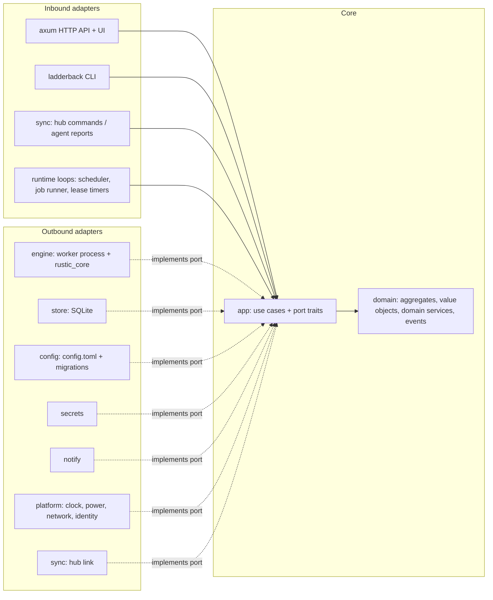

## 3. Architecture

### 3.0 Runtime topology

```
                       ┌──────────────────────── hub machine ─────────────────────────┐
  Browser ──HTTPS──►   │  ladderback serve --hub                                         │
  (Leptos WASM UI)     │   ├─ HTTP API + UI (axum)      ├─ Hub registry (agents, plans,│
                       │   ├─ Scheduler                 │   repo owners)               │
                       │   ├─ Op log (SQLite)           ├─ Maintenance runner          │
                       │   │                            │   (forget/prune/check)       │
                       │   └─ local agent ──spawns──►  ladderback worker ──► repo        │
                       └──────────────▲────────────────────────────────────────────────┘
                                      │ WebSocket (agent dials out, TLS, signed identity)
             ┌────────────────────────┼─────────────────────────┐
     ┌───────┴────────┐       ┌───────┴────────┐        ┌───────┴────────┐
     │ laptop (agent) │       │ server1 (agent)│        │ server2 (agent)│
     │ scheduler      │       │ scheduler      │        │ scheduler      │
     │ op log         │       │ op log         │        │ op log         │
     │ worker ─► repo │       │ worker ─► repo │        │ worker ─► repo │
     └────────────────┘       └────────────────┘        └────────────────┘
```

**One binary, three roles, plus an MCP server on demand:**

| Role | Command | Runs where | Responsibility |
|---|---|---|---|
| **Agent** | `ladderback serve` | every machine | Local config, scheduler, op log, spawning workers, local web UI. Works fully standalone. |
| **Hub** | `ladderback serve --hub` | one machine (often a server) | Everything an agent does, plus an agent registry, aggregated history, the repo ownership registry, maintenance for hub-managed repos, notifications |
| **Worker** | `ladderback worker` (internal) | spawned per operation | Runs exactly one `rustic_core` operation, streams events to stdout, then exits |
| **MCP server** | `ladderback mcp` (started by an MCP client) | wherever the client runs | Lets AI agents and scripts drive a running agent (a hub from M4b), or a headless session of their own, over stdio (§4.6) |

Every agent is useful alone. Hub mode is opt-in, and an agent that can't reach the hub keeps backing up on schedule. It stores events in a persistent outbox and replays them when it reconnects.

### 3.1 Domain model (DDD)

Ladderback's hard problems are domain rules, not CRUD: who may prune a repository, which snapshots a policy may delete, when a backup must give up, when a missed run catches up, what a restore may overwrite. Those rules get names, types and tests of their own, independent of rustic, SQLite, axum or the sync protocol.

**Ubiquitous language.** These terms mean exactly this in code, tests, UI copy and docs.

| Term | Meaning |
|---|---|
| Agent | One machine running `ladderback serve`, identified by its agent ID |
| Hub | The agent running `--hub`; holds the registry, ownership and aggregated history |
| Service | An agent the user's **service manager** runs in the background, from login on: a systemd user unit on Linux, a launchd agent on macOS. Its **service file** says what the manager runs: this `ladderback` program's `serve`. `ladderback install-service` writes the file and has the manager start it; `ladderback remove-service` has the manager stop it and removes the file (§12) |
| Plan | What to back up, from which agent, into which repository, when, and how long to keep it |
| Repository | A rustic repository, identified by its **repository ID**. An **alias** is one agent's local name for it |
| Operation | One run of one action (backup, forget, prune, check, restore, …) with a lifecycle: `Queued` → `Running` → `Succeeded` / `SucceededWithWarnings` / `Failed { reason }` / `Cancelled`. A missed deadline is `Failed { reason: DeadlinePassed }` |
| Trigger | What started an operation: `schedule`, `manual`, `catch-up`, `retry`, `hub` or `mcp` |
| Operation log (history) | The record of every operation: when it was queued, started and finished, how it ended, what the engine reported, and its first 10,000 warnings with the total. It is written as an operation runs and never needed to run one |
| Snapshot | A rustic snapshot, read from the repository; never created or edited except through an operation |
| Pack / index | rustic's terms: a pack is a file of the repository's data, written by a backup or a prune; the index lists what each pack holds. Data in a pack no index lists can't be reused by a backup, and a check warns about the pack until a prune removes it |
| Cache slot | One running worker's folder of rustic's cache for one repository: `<cache folder>/<repository ID>/<n>`, the lowest `n` no other running worker of that repository holds. The worker holds it with an exclusive lock while it runs, so no two workers share one, and the next operation on the repository reads the index, the snapshots and the tree packs from it instead of from the repository. Nothing in it is needed: a lost cache is read again (§4.1) |
| Snapshot host | The host name a snapshot records: its plan's `host`, else the agent's `hostname`, else the machine's own name, which rustic chooses |
| Snapshot time | When a snapshot was taken, with the offset of the clock that took it (`2026-11-10 23:30:00-06:00`). A calendar retention rule counts the snapshot on that clock's hour, day, week, month and year, wherever the forget runs (§16, decision 56) |
| Other host | A snapshot host in a repository this agent maintains that is none of this agent's: not the machine's own name, the agent's `hostname`, or any plan's `host`. A snapshot carrying this agent's own `ladderback-agent` tag is this host's whatever host it records, as one made before the machine was renamed. Its snapshots suggest that another machine writes to the repository and may maintain it too (§7.3) |
| Source filter | What a plan leaves out of its backup: glob patterns, glob files, ignore files such as `.gitignore`, marker files, extended attributes and other file systems (`SourceFilter`, §6.1) |
| Plan tags | `ladderback-plan:<id>` and `ladderback-agent:<id>`; they make a snapshot **managed** by a plan |
| Unmanaged group | Untagged snapshots, grouped by the repository's `group-by` |
| Orphaned group | Tagged snapshots whose plan or agent no longer exists |
| Adopt | Retag an unmanaged or orphaned group into a plan |
| Maintenance owner | The single party that runs forget, prune and check for a repository |
| Claim / Grant / Lease | An agent's request to own maintenance; the hub's acceptance; the time-limited, epoch-numbered form of that acceptance |
| Deadline | The latest time a backup may write its snapshot (I3) |
| Prune margin | 1 h + the longest recorded prune on that repository |
| Catch-up | One run in place of any number of runs missed while the agent was off or asleep |
| Next run | When a plan runs next: the schedule's next moment after the last run started (a cron expression's on the wall clock of its zone, or an `every` interval in real time), plus jitter; planned when a run starts and kept while the agent is away (§5) |
| Jitter | How far after its moment a run may be put, so that machines on one schedule don't start at once; never as far as the schedule's following moment |
| Wake | The machine waking from sleep, or its clock set forward: wall-clock time ran more than 2 min ahead of monotonic time between two samples of the clocks 30 s apart. A run missed meanwhile can catch up, and a catch-up run after a wake first waits up to 2 min for the network (§5) |
| Overlap policy | What a plan does when its next run comes due while its last run is still going: `skip` it (the default) or `queue` it to start once the last one ends (`Overlap`, §5) |
| Step-up confirmation | Re-entering the password (or typing the snapshot ID when auth is off) before a restore or download |

**Bounded contexts.**

| Context | Kind | Aggregates and domain services | Rules it protects |
|---|---|---|---|
| **Shared kernel** | — | `RepositoryId`, `AgentId`, `PlanId`, `OperationId`, `SnapshotRef { id, time, host, label, paths, tags }`, `Timestamp` | Used by every context; changes need agreement across all of them |
| **Planning** | Core | `AgentConfig` (root; owns `Plan` and `RepositoryConfig` entities), value objects `Schedule`, `RetentionPolicy`, `SourceFilter`, `Hooks`, `RetryPolicy`, `SecretRef` | Plan IDs unique per agent; a plan names an existing repository alias; schedules and retention validate |
| **Execution** | Core | `Operation` (root; one run's lifecycle), `PlanSchedule` (root; per plan: `next_run`, `last_success`, active operation, retry attempt), domain services `NextRun` (cron, interval, jitter, time zone, catch-up), `Deadline`, `RetrySchedule`, `WakeDetector` (wall-clock vs monotonic samples) | Valid lifecycle transitions; catch-up collapses missed runs; overlap policy; deadline (I3); retries stop at the next scheduled run |
| **Maintenance** | Core | `RepositoryOwnership` (root; claims, grant, lease, epoch; the "no other agent uses this repo" facts are passed in by the use case), domain services `ForgetSelection` (managed / orphaned / unmanaged partition and the delete list), `PruneGuard` | One owner (I1); never instant delete (I2); forget only touches managed snapshots (I6); serialized maintenance (I7, enforced atomically by the store) |
| **Restore** | Supporting | `RestoreRequest` (root), `RestorePolicy` | New folder by default; in-place only from the agent's own UI; hub restores need `allow-hub-restore`; step-up confirmation |
| **Fleet** | Supporting | `Agent` (root; identity, hostname), `PairingToken` (single use, TTL), `HostnameRegistry` domain service | Unique hostnames; tokens used once; re-pairing reuses identity |
| **Profile interop** | Supporting | Anti-corruption layer only (`adapters/interop`): translates rustic profiles to and from Planning | List replacement, hook order, `[snapshot-filter]` export rules (§6.2) |
| **Secrets** | Generic | `SecretRef`, `Redactor` (replaces every resolved secret value, and its common encodings, with `***`) | No secret in logs, templates or sync messages (I4) |
| **Notifications, auth** | Generic | Notification rules over domain events; sessions | — |

**Context map.** Planning feeds Execution (plans become operations) and, through the hub, Maintenance (published plans carry retention). Execution emits domain events that Maintenance, notifications and the sync outbox consume. Two anti-corruption layers keep foreign models out: profile interop for rustic's TOML model, and the engine adapter for `rustic_core`'s types. The sync protocol in `api` is the published language between agent and hub; `app` speaks its own `AgentReport` and `HubCommand` types, and the sync adapter translates.

**Domain events and their consumers.**

| Event | Consumed by |
|---|---|
| `OperationQueued`, `OperationStarted`, `OperationFinished { outcome }` | UI live updates, sync outbox, notifications (`backup.*`, `forget.failed`, `prune.failed`, `check.failed`) |
| `SnapshotCreated` | Snapshot catalog refresh |
| `RetryScheduled`, `BackupMissed` | Notifications (`backup.retrying`, `backup.missed`) |
| `CheckFoundErrors` | Notifications (`check.errors`) |
| `PruneRefused`, `ClaimRejected`, `MaintenancePaused { reason }` | Notifications (`prune.refused`, `repo.claim_rejected`, `repo.maintenance_paused`) |
| `MaintenanceGranted`, `LeaseExpired` | Maintenance scheduling on the agent |
| `UnmanagedGroupsFound` | Notifications (`repo.unmanaged_groups`), repository page |
| `AgentPaired`, `AgentWentOffline` | Dashboard; notifications (`agent.offline`) |

The sync outbox (§7.2) persists the events the hub needs.

**Retention evaluation stays in rustic.** `ForgetSelection` decides *which* snapshots each policy applies to; applying `keep-*` rules to a group is delegated to the `Retention` port, implemented with rustic's own `ForgetGroups`, so Ladderback never reimplements retention. The export golden test (§6.2) checks the two agree. A calendar rule counts each snapshot on the calendar of its own snapshot time, as rustic does, so the evaluation reads the repository's snapshot files, which carry the offset, never the listing's `Timestamp` (§16, decision 56).

**Outside input is parsed once, where it enters.** Text from outside the process (`config.toml`, HTTP requests, imported profiles, worker output, sync messages) becomes domain types in the adapter, or the `api` type, that receives it. `RepositoryAlias::parse`, `PlanId::parse`, `RepositoryId::parse` and the other value objects return either a value that keeps its rules or an error the adapter reports. `domain` and `app` take those types, never the raw string, and don't check them again. A type that can't hold an invalid value is preferred to a check plus the test that proves it: an enum for a closed set of states (`OperationStatus`), and a newtype with a private field and a `parse` constructor for a constrained value, with no public way around its rules.

### 3.2 Code architecture: hexagonal, with a DDD core

Ladderback's complexity sits at its edges: one set of rules is driven by an HTTP API, a CLI, a scheduler and hub commands, and it drives a rustic engine in a child process, SQLite, a WebSocket, OS keyrings, power and wake signals, notification channels and the clock. Ports and adapters name exactly that, and let every rule be tested with fakes for all of it.

| Option | Verdict |
|---|---|
| **Hexagonal (ports and adapters) around a DDD core** (chosen) | Fits many inbound drivers and many swappable outbound systems. The domain and application crates form two inner rings, as in Onion |
| Clean Architecture | Same dependency rule, but its presenters and interactor/output-port pairs add ceremony with no payoff: the UI is a separate WASM app consuming JSON |
| Onion | Equivalent rings; Hexagonal's port vocabulary describes the many external actors better. The inner split is borrowed from it |
| Layered by technology (v0.2's `daemon` crate holding server, scheduler, store and runner) | Rejected: lease, deadline and forget rules would sit next to axum and sqlx, untestable without them |



**Inbound ports (use cases in `app`).**

- **Agent:** `RunBackup`, `TickScheduler`, `CancelOperation`, `RunMaintenance` (forget, prune, check), `EnforceDeadlines`, `AdoptGroup`, `RequestRestore`, `Download`, `ImportProfile` / `ExportProfile`, `EditConfig`, `ApplyRepoGrants`, read-side queries for the dashboard.
- **Hub:** `PairAgent`, `ReportRepos` (claims), `DecideClaim`, `IngestHeartbeat`, `IngestOpEvents` (and acknowledge), `RenewLeases`, `ExpireLeases`, `MarkAgentOffline`, `ForwardCommand` (run, cancel, restore, fetch log).

Each adapter translates its input, calls one use case, and maps the result; no adapter holds a rule. The long-running loops (scheduler tick, job runner, lease timers, wake checks) are async functions in `app` driven by the `Clock` port; the composition root only spawns them.

**Outbound ports (traits in `app`).**

| Port | Capability | Real adapter | Test double |
|---|---|---|---|
| `Engine` | Repository ID, init, test connection, backup, list and delete snapshots, retag (for Adopt), prune, check, restore, ls, stats. `run` returns a `RunningJob`: a stream of `EngineEvent`s plus a `JobControl` whose `stop` ends the job gracefully (SIGTERM, a grace period, then SIGKILL); dropping the `RunningJob` kills the job at once. `dump` returns a byte stream carried on its own pipe, separate from the event stream | Spawns `ladderback worker` (links `rustic_core`) | Scripted fake engine |
| `Retention` | Pure: apply a `RetentionPolicy` to `SnapshotRef`s at a given `now` | `rustic_core::ForgetGroups`, in-process | Small keep-last / keep-within fake; the shared contract suite checks it against the real adapter |
| `OperationStore` | Operations and queue; `try_start` refuses a second running maintenance operation per repo (I7) | sqlx SQLite | In-memory |
| `ScheduleStore`, `SnapshotCatalog`, `Outbox`, `LeaseCache` (agent), `OwnershipRegistry` and `AgentRegistry` (hub) | Persistence | sqlx SQLite | In-memory |
| `ConfigStore` | Load (parsing and migrating old schemas), and atomically save `AgentConfig` | TOML file with version history | In-memory |
| `SecretResolver` | Resolve a `SecretRef` | Command, keyring, file, env | Map-backed fake |
| `Clock` | Wall-clock and monotonic time, `sleep_until` (wall-clock) and `sleep` (monotonic: time asleep doesn't count) | System clocks (`Instant`), tokio timers | Controllable fake clock that fires timers when advanced, and can `suspend` the machine (wall-clock time moves, monotonic time doesn't) |
| `Random` | Jitter, UUIDv7 IDs, epochs, pairing tokens | OS randomness | Seeded |
| `Identity` | The agent's Ed25519 key: public key and signing | Key file in the data dir | Fixed test key |
| `PowerSupply` | AC power or battery (§16, decision 63) | `/sys/class/power_supply` on Linux, `pmset -g batt` on macOS | Scripted fake |
| `Network` | Whether the machine is online (§16, decision 63) | `/sys/class/net` on Linux, `scutil --nwi` on macOS | Scripted fake |
| `ServiceManager` | Install, start, stop and remove the agent's user service (§12, decision 64) | systemd user unit through `systemctl --user` on Linux, launchd agent through `launchctl` on macOS | In-memory fake |
| `EventPublisher` | Deliver domain events to in-process subscribers (UI, outbox, notifications) | Broadcast channel | Recording fake |
| `Notifier` | Deliver a rendered notification | reqwest, lettre | Recording fake |
| `HubLink` / `AgentLink` | Send `AgentReport`s to the hub / `HubCommand`s to an agent | WebSocket sync | In-memory pair |
| `HookRunner` | Run hook commands with a scrubbed environment | Process spawner | Recording fake |

**Port style.** Ports are object-safe traits used as `Arc<dyn Port>`, written with `#[async_trait]` so their futures are `Send` and use cases can be spawned. One boxed future per port call costs nothing next to the I/O behind it, and the composition root stays readable with a dozen ports. Streams are `futures::stream::BoxStream`. No port signature mentions a tokio, sqlx, axum or rustic type.

**Port contract tests.** For each port, `app` exports a generic contract suite (feature `fakes`). The fake runs it in `app`'s tests, and each adapter crate runs the same suite against its real implementation, so a fake can't drift from reality.

**Dependency rule, enforced in CI.**

- `domain` has no I/O, no async and no ambient time or randomness. It may use `serde`, `uuid` (without `v4`/`v7` features), `jiff` (the workspace dependency turns on `tzdb-bundle-always`, so the build carries the IANA time-zone database and zones resolve on a host with no `tzdata`, such as a minimal container image, and in the browser, which has none; `jiff` reads the system's database first and uses the bundled one only when it finds none, §16 decision 30) and the cron crate `croner` with `default-features = false, features = ["jiff"]` (`chrono` is only croner's default; time goes through `jiff` alone, and `just architecture` bans `chrono` from `domain` and `app`, so a default-features slip fails CI; M0 confirms `jiff` and `croner` build for `wasm32`). Its error types implement `Display` and `Error` by hand: they carry codes and values, never sentences (§8.4).
- `app` depends only on `domain`, `async-trait` and `futures`.
- **Banned crates:** a CI step runs `cargo tree -e normal,build --prefix none` on `domain` (also with `--target wasm32-unknown-unknown`) and on `app`, and fails if `tokio`, `sqlx`, `axum`, `hyper`, `reqwest`, `rustic_core`, `rustic_backend`, `fluent-bundle`, `fluent-langneg`, `unic-langid`, `chrono` or any `icu_*` crate appears. Dev-dependencies are excluded, so tests may use a runtime.
- **Banned calls:** `clippy.toml` `disallowed-methods` / `disallowed-types` in `domain` and `app` forbid `std::fs`, the file-system methods of `std::path::Path`, `std::env`, `std::process`, `std::net`, `SystemTime::now`, `Instant::now`, `jiff::Timestamp::now`, `jiff::Zoned::now`, `Uuid::now_v7` and `rand`. Time and randomness come from `Clock` and `Random`. The two files are kept byte-identical, and the architecture check fails if they differ.
- **wasm build:** CI builds `domain` for `wasm32-unknown-unknown`. This proves the UI can reuse its validation (schedules, retention syntax); purity is enforced by the two checks above, not by the wasm build.
- Adapters depend on `app` and `domain`, never on each other. Only the composition root (`src/main.rs` and its `composition` module) knows every adapter and wires them per role: agent, hub, worker, CLI, MCP. `l10n` is a presentation library outside the rings, used by `web`, `adapters/notify` and the CLI (§8.4).
- The worker binary is an adapter: it maps a `JobSpec` onto `rustic_core` calls and reports events. It makes no policy decisions: deadlines, snapshot IDs to delete and retag targets all arrive in the `JobSpec`. Its watchdog is a thin loop that applies the `Deadline` rule from `domain`.
